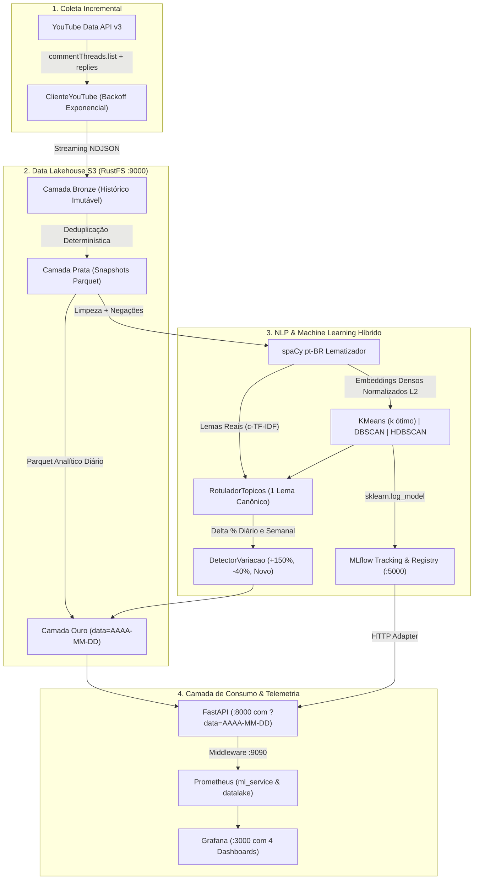
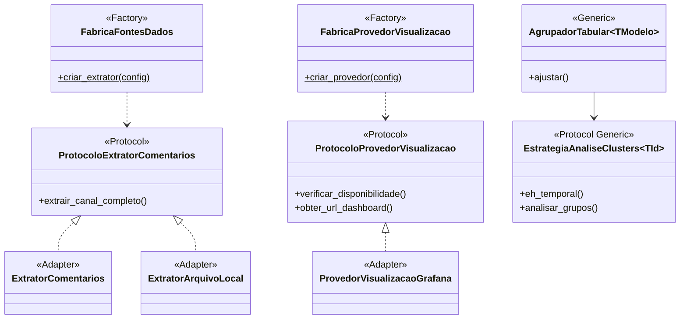

# YouTube Comments NLP & Trends — Pipeline Multiagente Antigravity

[](https://www.python.org/)
[](https://fastapi.tiangolo.com/)
[](https://docs.pytest.org/)
[](https://github.com/microsoft/pyright)
[](http://localhost:3000)
[](https://docs.docker.com/compose/)

Solução corporativa ponta a ponta para **coleta incremental**, **higienização textual**, **processamento de linguagem natural (spaCy)**, **representação híbrida (embeddings densos L2 + c-TF-IDF)**, **agrupamento não-supervisionado com seleção automática de clusters (KMeans, DBSCAN, HDBSCAN)**, **detecção de tendências temporais com segregação diária e variação percentual** e **publicação analítica via Data Lakehouse S3 (RustFS/MinIO)**, **FastAPI**, **MLflow**, **Prometheus** e **Grafana**.

---

## 🏛️ Arquitetura do Sistema e Data Lakehouse

O pipeline opera sob a arquitetura de medalhão em streaming de memória volátil (**zero datasets intermediários em disco local**):




---

## ⚡ Principais Funcionalidades

1. **Coleta Incremental Exaustiva:**
   - Ingestão de vídeos recentes por canal, tópicos de comentários (`commentThreads.list`) e todas as respostas filhas recursivas (`comments.list(parentId=...)`).
   - Resiliência contra esgotamento de quota e limitação de taxa via backoff exponencial.

2. **Datalakehouse S3 com Idempotência e Segregação Diária:**
   - **Camada Bronze:** Registros brutos particionados por `data_coleta=YYYY-MM-DD/lote=<uuid>.jsonl`.
   - **Camada Prata:** Deduplicação determinística em memória pelo `id_comentario`, mantendo a versão mais recente em Apache Parquet colunar tipado.
   - **Camada Ouro:** Particionamento analítico diário `data=AAAA-MM-DD` preservando histórico completo sem risco de sobrescrita. Suporta consultas com fallback autônomo para a data mais recente.

3. **Engenharia de NLP & Representação Vetorial (TF-IDF vs. Abordagem Híbrida):**
   - **LimpadorTexto (`app/tratamento_texto/`):** Higienização de ruídos preservando termos polarizadores de negação (`não`, `nunca`, `sem`, `nem`).
   - **spaCy pt-BR Lematizador:** POS Tagging estrito (`NOUN`, `PROPN`, `ADJ`) e lematização morfológica para redução ao radical canônico dicionarizado.
   - **VetorizadorTfidf (`app/representacao_texto/`):** Projeta comentários lematizados em matrizes esparsas `scipy.sparse.csr_matrix` com sublinear TF ($1 + \log(TF)$), n-grams `[1, 2]` e normalização $L_2$. Garante **ortogonalidade pura** ($\cos(\theta) = 0$ entre tópicos distintos), eliminando ruídos de similaridade artificial entre assuntos não correlatos.
   - **ExtratorEmbeddings (`app/representacao_texto/`):** Suporte opcional a representação contínua densa baseada em embeddings do spaCy com normalização $L_2$.
   - **ExtratorBertimbau (`app/representacao_texto/`):** Representação semântica contextualizada de alta resolução (768 dimensões) baseada em Sentence-Transformers e BERTimbau (`neuralmind/bert-base-portuguese-cased`), com lazy loading e normalização $L_2$.
   - **RedutorUmap (`app/representacao_texto/`):** Redução dimensional não-linear via UMAP (*Uniform Manifold Approximation and Projection*) que projeta os embeddings de 768d para 5 dimensões densas. Preserva variedades topológicas locais/globais e elimina a maldição da dimensionalidade, potencializando o HDBSCAN e DBSCAN.
   - **RotuladorTopicos (c-TF-IDF):** Eleição estatística não-LLM de exatamente **um lema canônico válido** por cluster ponderando frequência local vs dispersão no corpus global.
   - **Discussão de Engenharia: TF-IDF vs. Híbrida vs. BERTimbau + UMAP:**
     - *TF-IDF Puro (Recomendado para Produção):* Evita o colapso por encadeamento (*chaining*) no DBSCAN e a sub-clusterização no KMeans ($k=2$). Proporciona centróides 100% interpretáveis e pegada de memória mínima (< 15 MB).
     - *Abordagem Híbrida (spaCy):* Desacopla o agrupamento (espaço contínuo denso) da rotulagem (c-TF-IDF). Recomendada para canais de nicho monomático quando utilizada com `pt_core_news_lg` (500k vetores reais de 300d).
     - *Sentence-Transformers / BERTimbau + UMAP (Padrão-Ouro):* Espaço vetorial contextualizado de 768 dimensões reduzido topologicamente para 5 dimensões via UMAP, gerando agrupamentos hiper-específicos e coesos no HDBSCAN, DBSCAN e KMeans com alta interpretabilidade.
     - *Seleção Declarativa:* Configurável via `processamento.representacao.tecnica: tfidf | hibrida | bertimbau` e `processamento.reducao.ativa: true` em `config/entradas.yaml`.

4. **Clusterização Comparativa & Técnicas de Agrupamento:**
   - **KMeans (Particional com Auto-k):** Minimiza a inércia intra-cluster ($WCSS$). Conta com **seleção autônoma do número ótimo de clusters ($k$)** no intervalo configurado `[k_min, k_max]` via maximização do **Silhouette Score**, desempate por Calinski-Harabasz/Davies-Bouldin e salvamento do modelo no MLflow Model Registry. Permite extração de **centróides semânticos** (top termos TF-IDF) e **comentário exemplar (protótipo)**.
   - **DBSCAN (Densidade Espacial):** Agrupamento contínuo baseado em densidade espacial com **métrica de Cosseno** ($1 - \cos(\theta)$), ideal para vetores esparsos de texto. Isola spams, gírias desconexas e comentários atípicos com o rótulo formal de **ruído (`-1` / `sem_topico`)**, mantendo a alta pureza temática dos grupos descobertos.
   - **HDBSCAN (Hierárquico com Persistência):** Constrói árvore geradora mínima por distância de alcance mútuo (Mutual Reachability Distance) e seleciona clusters estáveis por persistência ($\lambda = 1 / d$), sem necessidade de estipular o raio $\epsilon$ e gerando probabilidades contínuas de pertinência ($p \in [0, 1]$) e escores de outlier GLOSH.
   - **Métricas Matemáticas Auditadas:** Silhouette Score, Davies-Bouldin Index, Calinski-Harabasz Index (Variance Ratio Criterion) e Razão de Ruído.

| Algoritmo | Paradigma | Determinação de Clusters | Ruído / Outliers | Métrica Recomendada | Caso de Uso nos Comentários |
| :--- | :--- | :--- | :--- | :--- | :--- |
| **K-Means** | Particional | Automática via Silhouette Score (`k_min` a `k_max`) | Força todos em clusters | Euclidiana ($L_2$ normalizado) | Visão executiva balanceada, centróides com palavras-chave |
| **DBSCAN** | Densidade Espacial | Descoberto por densidade ($\epsilon$ e $MinPts$) | Isola como ruído (`-1`) | Distância Cosseno | Foco em tópicos densos e expurgo de ruídos/spams |
| **HDBSCAN** | Hierárquico | Extraído por persistência e longevidade | Isola ruído + probabilidades | Alcance Mútuo / Euclidiana | Comunidades com nichos de densidades heterogêneas |

5. **Análise de Tendências em Série Temporal Diária (`app/analise_tendencias/`):**
   - **Modelagem de Série Temporal:** Em vez de janelas arbitrárias ou intervalos deslizantes que misturam dias, o cálculo é estritamente pontual dia a dia (Hoje $T_0$ vs Ontem $T_{-1}$).
   - **Ciclo Temporal Contínuo:** Quando a coleta executa amanhã ($T_1$), o volume apurado hoje ($T_0$) torna-se automaticamente a `contagem_anterior`. Tópicos em alta desaceleram para `decrescendo` (ex: de 26 para 12 comentários, $-53.8\%$), assuntos emergentes superam o baseline virando `crescendo` (ex: de 4 para 8 comentários, $+100.0\%$) e termos inéditos recebem status `novo` ($+100.0\%$).
   - **`detector_variacao.py` (`DetectorVariacao`):** Calcula a variação proporcional $\Delta$ e o **percentual explícito com sinal** (+150.0%, -60.0%, +100.0% para tópicos novos, 0.0% para estável). Classifica nos status `novo`, `crescendo`, `decrescendo`, `estavel` e `sem_dados`.
   - **`calculador_tendencias.py` (`CalculadorTendencias`):** Segmenta os comentários por dia de referência (`data_referencia: AAAA-MM-DD`), preserva amostras reais e grava registros com partição analítica diária na camada Ouro (`.../data=AAAA-MM-DD/topicos.parquet`).
   - **`agregador_visoes.py` (`AgregadorVisoes`):** Consolida a visão macroscópica diária do canal, agregando percentuais e comentários protótipos de todos os vídeos.
   - **Série Temporal Histórica:** O endpoint `/v1/canais/{id_canal}/topicos/{topico}/serie_temporal` permite recuperar a linha do tempo completa de qualquer termo ao longo dos dias.

6. **Observabilidade e Dashboards Grafana Provisionados (:3000):**
   - **Sincronização Ativa de Armazenamento:** A API sincroniza no startup (`MedidorDatalake.sincronizar_metricas_existentes`) o estado real do Lakehouse S3/RustFS diretamente nos contadores do Prometheus, garantindo que o dashboard de Lakehouse exiba o total em bytes, arquivos e registros imediatamente.
   - **Data Lakehouse & Storage S3 (`yt-datalake-lakehouse`):** Volume total persistido (Bytes) por camada (Gauge e Donut por Bronze, Prata e Ouro), contagem de arquivos (`.jsonl` e `.parquet`), registros gravados por camada, latência de I/O e stream de logs do RustFS via Loki.
   - **API FastAPI & Serving Operacional (`yt-api-fastapi`):** Requisições por endpoint, RPS, latência p50/p95/p99 e status HTTP.
   - **Pipeline Operacional & Ingestão (`yt-pipe-operacional`):** Comentários coletados, taxa de ingestão por minuto e logs estruturados.
   - **Qualidade de Agrupamento & Modelos (`yt-clusters-modelos`):** Silhouette Scores, fração de ruído e quantidade de clusters.

6. **MLOps & Persistência no MLflow:**
   - Registro automático de runs com métricas de agrupamento, parâmetros (`k_otimo`) e tags de manifesto S3.
   - Persistência do modelo scikit-learn treinado via `mlflow.sklearn.log_model`.
   - Registro e versionamento no **MLflow Model Registry** sob `modelo_kmeans_youtube`.

7. **Tipos Enumerados Fortes (`StrEnum`):**
   - Eliminação de magic strings literais através de enums canônicos em `app/configuracao_geral/tipos_enumerados.py` (`TecnicaCluster`, `JanelaTemporal`, `StatusTendencia`, `CamadaLakehouse`, etc.).

---

### 📦 Estrutura dos Módulos do Sistema (Convenção de Duas Palavras)

| Pacote | Módulos Internos | Responsabilidade Arquitetural |
| :--- | :--- | :--- |
| **`analise_tendencias/`** | `detector_variacao.py`<br>`calculador_tendencias.py`<br>`agregador_visoes.py` | Métricas de variação temporal, série temporal diária e consolidação macroscópica por canal. |
| **`coleta_youtube/`** | `cliente_youtube.py`<br>`extrator_comentarios.py`<br>`modelos_coleta.py` | YouTube Data API v3, paginação recursiva de respostas e resiliência de rate limit com backoff. |
| **`gestao_dados/`** | `cliente_s3.py`<br>`camada_bronze.py`<br>`camada_prata.py`<br>`camada_ouro.py` | Lakehouse S3/RustFS (Bronze NDJSON, Prata Parquet deduplicado, Ouro Parquet analítico particionado por data). |
| **`tratamento_texto/`** | `limpador_texto.py`<br>`lematizador_spacy.py`<br>`rotulador_topicos.py` | Higienização com preservação de negações, lematização spaCy e rotulagem determinística não-LLM. |
| **`representacao_texto/`**| `extrator_bertimbau.py`<br>`extrator_embeddings.py`<br>`vetorizador_tfidf.py`<br>`redutor_dimensionalidade.py`<br>`fabrica_representacao.py` | Embeddings contextuais BERTimbau (Sentence-Transformers 768d), embeddings spaCy L2, TF-IDF esparso e SVD opcional. |
| **`agrupamento_modelos/`**| `avaliador_qualidade.py`<br>`agrupador_kmeans.py`<br>`agrupador_dbscan.py`<br>`agrupador_hdbscan.py`<br>`fabrica_agrupadores.py` | Estratégias desacopladas de clustering (KMeans auto-k, DBSCAN e HDBSCAN) e cálculo de métricas. |
| **`integracao_mlflow/`** | `rastreador_experimentos.py`<br>`adaptador_serving.py` | MLflow Tracking, persistência de artefatos de modelos e cliente HTTP para MLflow Model Serving. |
| **`coleta_metricas/`** | `medidor_coleta.py`<br>`medidor_modelos.py`<br>`medidor_datalake.py`<br>`middleware_prometheus.py` | Telemetria Prometheus para Lakehouse S3, métricas de clusters sem alta cardinalidade e middleware HTTP. |
| **`servico_api/`** | `aplicacao_fastapi.py`<br>`rotas_videos.py`<br>`rotas_canais.py`<br>`rotas_inferencias.py`<br>`esquemas_respostas.py` | API REST FastAPI com 11 rotas tipadas, suporte a série temporal diária, `?data=AAAA-MM-DD`, CORS e centróides. |
| **`orquestracao_pipeline/`**| `executor_ciclo.py`<br>`protocolos_ciclo.py`<br>`despachante_alertas.py` | Orquestrador facade ponta a ponta e contratos estruturais (`Protocol`) para desacoplamento e inversão de dependências (DIP). |
| **`configuracao_geral/`** | `provedor_configuracao.py`<br>`modelos_configuracao.py`<br>`tipos_enumerados.py` | Carregamento tipado e imutável de `config/entradas.yaml` e enums canônicos `StrEnum`. |

---

## 💼 Guia de Interpretação para a Equipe de Negócio e Produto

O sistema foi desenhado para transformar volumes maciços de texto não-estruturado em **decisões práticas de crescimento, retenção e monetização**:

### 🎯 Dicionário Executivo
- **Tópico (Lema Único):** O *assunto central* matemático debatido (ex: `energia`, `preco`, `audio`). Sem alucinação de IA generativa, 100% auditável.
- **Percentual de Variação:** O percentual relativo de crescimento ou queda com sinal explícito (ex: `+150.0%`, `-40.0%`, `+100.0%` para novos).
- **Série Temporal Diária:** Histórico particionado dia a dia, permitindo analisar tópicos na data de hoje e na data de amanhã, medindo o crescimento ou arrefecimento ao longo do tempo.
- **Centróide (Top Termos):** O *radar semântico* que responde *"em que contexto as pessoas estão falando deste tema?"* (ex: se o tópico for `audio`, os termos `baixo` e `chiado` apontam para um defeito técnico na gravação).
- **Comentário Protótipo (Medoide):** A *voz da comunidade* sintetizada no comentário real mais representativo, dispensando a leitura manual de milhares de mensagens.
- **Tendência Temporal (`novo`, `crescendo`, `decrescendo`, `estavel`):** O *termômetro de atenção* da audiência para antecipar pautas antes da concorrência.
- **Fração de Ruído:** O *indicador de pureza*. Menos de 25% de ruído comprova uma comunidade altamente atenta e qualificada para patrocinadores.

### 🚀 Playbooks de Ação Prática
1. **Pauta Editorial & Growth:** Filtrar tópicos em `crescendo` ou `novo` na data de hoje para pautar o próximo vídeo, live ou short antes que o assunto esfrie.
2. **Análise de Série Temporal:** Avaliar no endpoint `/serie_temporal` se um tópico foi um pico pontual de 1 dia ou se sustenta crescimento constante ao longo da semana.
3. **Voice of Customer (VOC) & Produto:** Monitorar centróides com termos negativos (`bug`, `erro`, `dificuldade`) para alertar o time de engenharia e suporte.
4. **Mídia Kit & Parcerias Comerciais:** Apresentar dados quantitativos do Lakehouse para provar aderência e interesse da base a patrocinadores em potencial.
5. **Eficiência de Community Management:** Moderar e interagir focando nos comentários protótipos que cobrem 90% das reações do público.

---

## 🌐 Endpoints da API REST (FastAPI na porta 8000)

A aplicação expõe rotas totalmente documentadas com esquemas Pydantic v2 e validação em tempo de execução:

| Método | Endpoint | Finalidade |
| :--- | :--- | :--- |
| `GET` | `/health` | Checagem de disponibilidade e saúde do serviço |
| `GET` | `/metrics` | Telemetria oficial para coleta pelo Prometheus |
| `GET` | `/documentacao` | **Documentação técnica interativa completa em HTML** |
| `GET` | `/v1/canais/{id_canal}/videos` | Catálogo dos vídeos com metadados do canal |
| `GET` | `/v1/canais/{id_canal}/tendencias` | Tendências consolidadas do canal (com filtro opcional `?data=AAAA-MM-DD`) |
| `GET` | `/v1/canais/{id_canal}/topicos/{topico}/serie_temporal` | **Série temporal histórica do tópico ao longo dos dias (datas, contagens e deltas %)** |
| `GET` | `/v1/canais/{id_canal}/topicos/{topico}/comentarios` | **Histórico acumulado de comentários vinculados ao tópico no canal inteiro (paginado)** |
| `GET` | `/v1/canais/{id_canal}/centroides` | **Centróides semânticos: busca por canal ou filtrada por vídeo (`?id_video=...`)** |
| `GET` | `/v1/canais/{id_canal}/videos/{id_video}/tendencias` | Tópicos, deltas percentuais e todos os comentários do dia do vídeo (`?data=AAAA-MM-DD`) |
| `GET` | `/v1/canais/{id_canal}/videos/{id_video}/clusters` | Distribuição estrutural, percentual e fração de ruído |
| `GET` | `/v1/canais/{id_canal}/videos/{id_video}/centroides` | Análise semântica dos centróides, top termos e comentário exemplar |
| `GET` | `/v1/canais/{id_canal}/videos/{id_video}/topicos/{topico}/comentarios` | **Histórico acumulado de comentários vinculados ao tópico no vídeo (paginado)** |
| `POST`| `/v1/inferencias` | Predição de cluster para novos textos via MLflow Serving Adapter |

> **Documentação Interativa:** Acesse `http://localhost:8000/documentacao` ou a UI do Swagger em `http://localhost:8000/docs`.

---

---

## ⚙️ Parametrização Declarativa via `config/entradas.yaml`

Todos os subsistemas do pipeline são desacoplados e ajustáveis sem necessidade de alterações no código-fonte Python:

| Subsistema | Parâmetros Declarativos | Finalidade & Comportamento |
| :--- | :--- | :--- |
| **Representação & TF-IDF** | `sublinear_tf: true`<br>`norma: "l2"`<br>`min_df: 2`, `max_df: 0.95`<br>`ngram_range: [1, 2]` | Amortecimento logarítmico sublinear de frequência de termos, normalização euclidiana L2 e extração de unigramas e bigramas. |
| **Stopwords & Ruídos** | `usar_spacy: true`<br>`adicionais: [...]`<br>`preservar: [nao, nunca, sem]`<br>`filtro_centroides: [...]` | Preservação de negações essenciais para polaridade e filtragem fina de palavras funcionais nos centróides semânticos da API. |
| **Agrupadores (KMeans)** | `n_clusters: 8`, `n_init: 10`<br>`k_automatico: true`<br>`k_min: 2`, `k_max: 10`<br>`max_iter: 300` | Busca ótima de $k$ baseada em Silhueta Máxima, número de inicializações e limite máximo de iterações por rodada. |
| **Agrupadores (DBSCAN / HDBSCAN)** | `eps: 0.5`, `min_samples: 5`<br>`algorithm: "auto"`<br>`min_cluster_size: 8`<br>`cluster_selection_method: "eom"` | Métrica angular (cosseno), algoritmo de vizinhança e método de extração de clusters hierárquicos (*Excess of Mass*). |
| **Rotulagem de Tópicos** | `pos_permitidas: [NOUN, PROPN, ADJ]`<br>`comprimento_minimo: 3`<br>`peso_tfidf: 0.7`, `peso_frequencia: 0.3`<br>`limiar_penalizacao_global: 0.75`<br>`fator_penalidade: 0.2`<br>`rotulo_ruido_padrao: "sem_topico"` | Score estatístico balanceado, penalização de termos hiper-frequentes acima do limiar configurado e rótulo seguro de ruído. |
| **Tendências Temporais** | `minimo_comentarios: 5`<br>`crescimento_minimo_proporcao: 0.10`<br>`queda_minima_proporcao: 0.10`<br>`max_amostras_video: 5`<br>`max_amostras_canal: 10` | Série temporal diária pontual, limiares de sensibilidade para alta/queda e teto de comentários exemplares persistidos na camada Ouro particionados por data. |
| **FastAPI & Servidor** | `porta: 8000`<br>`tempo_limite_segundos: 30`<br>`cors_origens: ["*"]`<br>`top_termos_padrao: 5`<br>`tamanho_pagina_padrao: 10`<br>`tamanho_pagina_maximo: 100` | Configuração de segurança CORS, timeouts de requisição e limites padronizados de paginação REST. |

---

## 🚀 Como Executar o Projeto

### 1. Pré-requisitos
- Docker & Docker Compose
- Python 3.12 instalado (caso execute localmente fora do container)
- Chave da YouTube Data API v3 configurada em `.env`:
  ```bash
  YOUTUBE_API_KEY="SUA_CHAVE_AQUI"
  ```

### 2. Subir os Serviços de Infraestrutura
```bash
# Sobe Storage S3 (RustFS), MLflow, Postgres, Prometheus, Grafana e API FastAPI
docker compose --profile servico_ml up -d
```

### 3. Disparar o Pipeline para um Canal
```bash
# Executa a coleta, lakehouse, NLP, clustering e cálculo de tendências
./executar_ciclo.sh UCoLf24olVUtKOsSXlqv_-ag
```

### 4. Executar a Suíte de Testes e Validação Estrita
```bash
# Executar todos os 50 testes automatizados
.venv/bin/pytest tests/

# Executar a validação de tipagem estrita (Pyright Strict Mode)
.venv/bin/pyright
```

### 5. Limpeza e Governança do Data Lakehouse S3
O Lakehouse utiliza particionamento temporal em formato Hive (`data=AAAA-MM-DD`). Caso deseje esvaziar camadas específicas ou o bucket completo de forma segura e recursiva (sem depender de limitações de interfaces web):
```bash
# Simulação (mostra a volumetria sem remover nada):
.venv/bin/python scripts/limpar_lakehouse.py

# Exclusão recursiva de todas as camadas (bronze, prata e ouro):
.venv/bin/python scripts/limpar_lakehouse.py --confirmar

# Exclusão recursiva de uma camada específica:
.venv/bin/python scripts/limpar_lakehouse.py --camada bronze --confirmar
.venv/bin/python scripts/limpar_lakehouse.py --camada prata --confirmar
.venv/bin/python scripts/limpar_lakehouse.py --camada ouro --confirmar
```

---

## 📐 Padrões de Projeto e Regras de Engenharia

O projeto adere estritamente às seguintes diretrizes arquiteturais:
- **Regra de Nomenclatura:** Todo módulo e pacote em `app/` e `tests/` possui **exatamente duas palavras separadas por sublinhado** (ex.: `agrupador_kmeans.py`, `provedor_configuracao.py`, `tipos_enumerados.py`).
- **Adapter Pattern:**
  - **Fontes de Dados:** `ExtratorArquivoLocal` e `ExtratorComentarios` adaptam formatos heterogêneos (YouTube API, CSV, Parquet, JSONL) ao contrato `ProtocoloExtratorComentarios`.
  - **Observabilidade:** `ProvedorVisualizacaoGrafana` isola o Grafana sob o contrato `ProtocoloProvedorVisualizacao`.
  - **Model Serving:** `AdaptadorServing` adapta o protocolo REST do MLflow Model Serving para a interface interna da API.
- **Factory Pattern:** Instanciação centralizada parametrizada via YAML (`FabricaFontesDados`, `FabricaAgrupadores`, `FabricaProvedorVisualizacao`).
- **Strategy Pattern:** Desacoplamento polimórfico dos algoritmos de clusterização (`AgrupadorKMeans`, `AgrupadorDBSCAN`, `AgrupadorHDBSCAN`) e de análise de distribuição (`EstrategiaAnaliseTemporal` e `EstrategiaAnaliseEstatica`).
- **Null Object Pattern:** `ProvedorVisualizacaoNulo` para execução segura sem grafana ou visualização desativada.
- **Facade / Orchestrator & Dependency Inversion (DIP):** Coordenação linear e transacional do pipeline completo desacoplada via interface estrutural (`ProtocoloExecutorCiclo` implementado por `ExecutorCiclo`). Inversão de dependências com protocolos para extração, camadas do Lakehouse, lematização e cálculo de tendências.
- **Type-Safe Enumerations & Generics:** Classes canônicas `StrEnum` com interoperabilidade Pydantic v2 e componentes genéricos parametrizados com `TypeVar` e `Generic[T]`.
- **Princípios SOLID:** 100% de conformidade com SRP, OCP, LSP, ISP e DIP (Inversão de Dependências via `typing.Protocol` com `@runtime_checkable`).

---

## 📊 Diagramas UML do Sistema

A documentação visual completa do sistema com diagramas interativos Mermaid está disponível em:
👉 **[Documentação Completa de Diagramas UML (docs/diagramas_uml.md)](file:///home/rodrigo/PycharmProjects/agrupamento_comentarios_youtube/docs/diagramas_uml.md)**

### Diagrama de Classes Simplificado (Arquitetura Central)



Para conferir os diagramas de **Atividades com Raias (Swimlanes)**, **Sequência Ponta a Ponta**, **Componentes de Infraestrutura** e **Máquina de Estados**, acesse o documento dedicado [`docs/diagramas_uml.md`](file:///home/rodrigo/PycharmProjects/agrupamento_comentarios_youtube/docs/diagramas_uml.md) e o portal web [`docs/index.html`](file:///home/rodrigo/PycharmProjects/agrupamento_comentarios_youtube/docs/index.html) com suporte a zoom vetorial e visualização em tela cheia.

