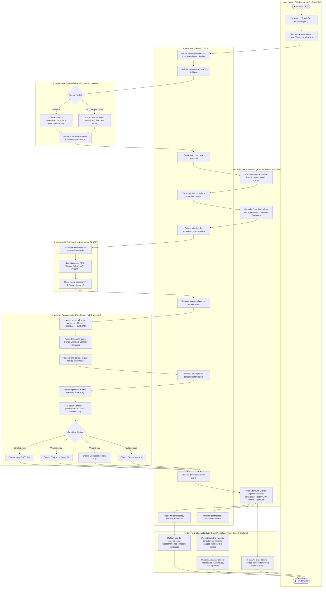
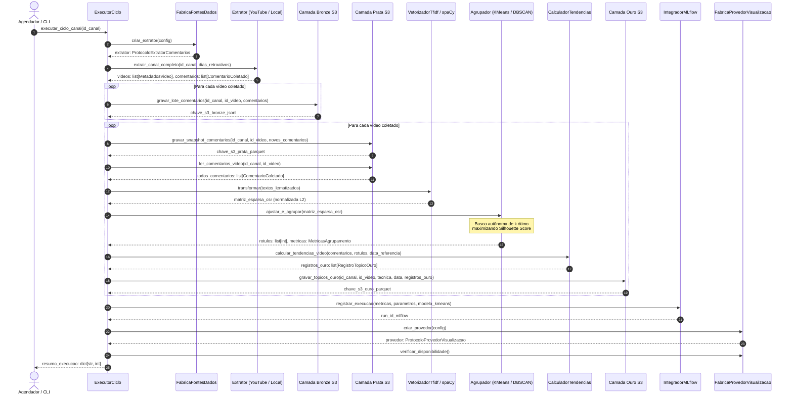
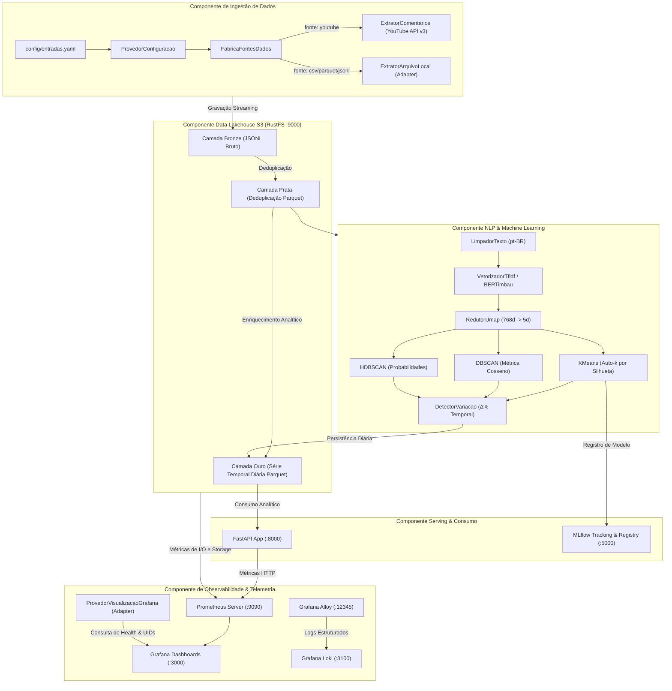
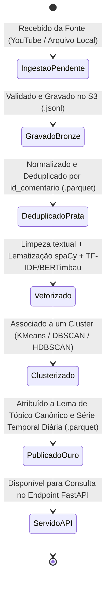
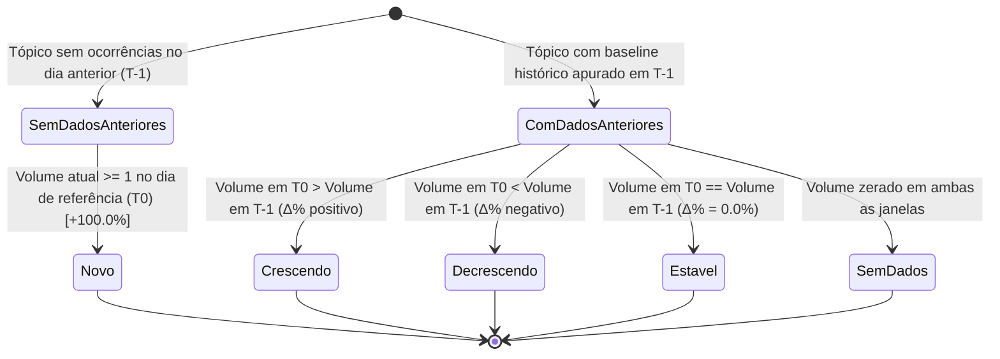

# Diagramas UML e Arquitetura do Sistema

Este documento reúne a modelagem visual canônica do projeto **YouTube Comments NLP & Trends Multiagente**, documentando os padrões de projeto consolidados (**Adapter**, **Factory**, **Strategy**, **Null Object**, **Protocols estruturais**, **Generics** e **TypeVar**).

---

## 1. Diagrama de Classes UML (Class Diagram)

O diagrama abaixo detalha o desacoplamento arquitetural entre as camadas de **Ingestão**, **Processamento Tabular/NLP**, **Agrupamento de Modelos**, **Estratégias de Tendências**, **Persistência Lakehouse** e **Visualização Operacional**:

```mermaid
classDiagram
    %% =========================================================================
    %% 1. FONTES DE DADOS E INGESTÃO (Adapter & Factory Pattern)
    %% =========================================================================
    class ProtocoloExtratorComentarios {
        <<Protocol>>
        +extrair_canal_completo(id_canal, dias_retroativos, incluir_respostas, limite_videos, tamanho_pagina) tuple[list~MetadadosVideo~, list~ComentarioColetado~]
        +obter_detalhes_canal(id_canal) tuple[str, str]
    }

    class FabricaFontesDados {
        <<Factory>>
        +_registro_extratores: dict
        +registrar_fonte(tipo, construtor)$ void
        +criar_extrator(config)$ ProtocoloExtratorComentarios
    }

    class ExtratorComentarios {
        <<Adapter>>
        -_cliente: ClienteYouTube
        +extrair_canal_completo(...)
        +obter_detalhes_canal(...)
    }

    class ExtratorArquivoLocal {
        <<Adapter>>
        -_caminho_dados: Path
        -_motor: MotorProcessamento
        -_coluna_texto: str
        -_coluna_id: str
        -_coluna_temporal: str
        +extrair_canal_completo(...)
        +obter_detalhes_canal(...)
    }

    class ClienteYouTube {
        -_chave_api: str
        -_servico: Resource
        +buscar_videos_recentes(...)
        +listar_comentarios_video(...)
    }

    ProtocoloExtratorComentarios <|.. ExtratorComentarios : implements
    ProtocoloExtratorComentarios <|.. ExtratorArquivoLocal : implements
    ExtratorComentarios --> ClienteYouTube : usa
    FabricaFontesDados ..> ProtocoloExtratorComentarios : instancia

    %% =========================================================================
    %% 2. MOTOR DE CLUSTERIZAÇÃO (Strategy, Factory, Generics & TypeVar)
    %% =========================================================================
    class FabricaAgrupadores {
        <<Factory>>
        +criar_kmeans(n_clusters, random_state, k_automatico, ...)$ AgrupadorKMeans
        +criar_dbscan(eps, min_samples, metric, ...)$ AgrupadorDBSCAN
        +criar_hdbscan(min_cluster_size, min_samples, metric, ...)$ AgrupadorHDBSCAN
    }

    class AgrupadorKMeans {
        <<Strategy>>
        -_k_automatico: bool
        -_k_otimo: int
        -_modelo: KMeans
        -_rotulos: list~int~
        -_historico_k: dict~int, float~
        +labels_: np.ndarray
        +ajustar_e_agrupar(matriz) tuple[list~int~, MetricasAgrupamento]
        +obter_rotulos() list~int~
        +obter_centroides() np.ndarray
        +obter_modelo() KMeans
    }

    class AgrupadorDBSCAN {
        <<Strategy>>
        -_eps: float
        -_min_samples: int
        -_metric: str
        -_modelo: DBSCAN
        +ajustar_e_agrupar(matriz) tuple[list~int~, MetricasAgrupamento]
        +obter_modelo() DBSCAN
    }

    class AgrupadorHDBSCAN {
        <<Strategy>>
        -_min_cluster_size: int
        -_min_samples: int
        -_modelo: HDBSCAN
        +ajustar_e_agrupar(matriz) tuple[list~int~, MetricasAgrupamento]
        +obter_probabilidades() np.ndarray
        +obter_modelo() HDBSCAN
    }

    class AgrupadorTabular~TModelo~ {
        <<Generic Class>>
        -_agrupadores: dict~str, Any~
        -_estrategia: EstrategiaAnaliseClusters
        +ajustar(matriz_ou_df) ResultadoAgrupamentoTabular~TModelo~
        +analisar_distribuicao_clusters(...) list~ResultadoAnaliseCluster~
    }

    FabricaAgrupadores ..> AgrupadorKMeans : cria
    FabricaAgrupadores ..> AgrupadorDBSCAN : cria
    FabricaAgrupadores ..> AgrupadorHDBSCAN : cria
    AgrupadorTabular o-- AgrupadorKMeans : compõe
    AgrupadorTabular o-- AgrupadorDBSCAN : compõe
    AgrupadorTabular o-- AgrupadorHDBSCAN : compõe

    %% =========================================================================
    %% 3. ESTRATÉGIAS DE ANÁLISE DE TENDÊNCIAS (Strategy & Generics)
    %% =========================================================================
    class EstrategiaAnaliseClusters~TId~ {
        <<Protocol Generic>>
        +eh_temporal() bool
        +analisar_grupos(grupos_atuais, grupos_anteriores) list~ResultadoAnaliseCluster~TId~~
    }

    class EstrategiaAnaliseTemporal {
        <<Strategy>>
        -_detector: DetectorVariacao
        +eh_temporal() bool
        +analisar_grupos(...) list~ResultadoAnaliseCluster~str~~
    }

    class EstrategiaAnaliseEstatica {
        <<Strategy>>
        -_minimo_amostras: int
        +eh_temporal() bool
        +analisar_grupos(...) list~ResultadoAnaliseCluster~str~~
    }

    EstrategiaAnaliseClusters <|.. EstrategiaAnaliseTemporal : implements
    EstrategiaAnaliseClusters <|.. EstrategiaAnaliseEstatica : implements
    AgrupadorTabular --> EstrategiaAnaliseClusters : delega

    %% =========================================================================
    %% 4. CAMADAS DO DATA LAKEHOUSE (Repository / Persistence Pattern)
    %% =========================================================================
    class ProtocoloCamadaBronze {
        <<Protocol>>
        +gravar_lote_comentarios(id_canal, id_video, comentarios) str
    }

    class ProtocoloCamadaPrata {
        <<Protocol>>
        +gravar_snapshot_comentarios(id_canal, id_video, novos_comentarios) str
        +ler_comentarios_video(id_canal, id_video) list~ComentarioColetado~
    }

    class ProtocoloCamadaOuro {
        <<Protocol>>
        +gravar_topicos_ouro(id_canal, id_video, tecnica, data_referencia, registros) str
        +ler_topicos_ouro(id_canal, id_video, tecnica, data_referencia) list~RegistroTopicoOuro~
    }

    class CamadaBronze {
        -_storage: ClienteStorageS3
        +gravar_lote_comentarios(...)
    }

    class CamadaPrata {
        -_storage: ClienteStorageS3
        +gravar_snapshot_comentarios(...)
        +ler_comentarios_video(...)
    }

    class CamadaOuro {
        -_storage: ClienteStorageS3
        +gravar_topicos_ouro(...)
        +ler_topicos_ouro(...)
    }

    class ClienteStorageS3 {
        -_cliente_s3: boto3.client
        -_bucket: str
        +enviar_bytes(chave, dados, content_type)
        +baixar_bytes(chave) bytes
        +listar_chaves(prefixo) list~str~
    }

    ProtocoloCamadaBronze <|.. CamadaBronze : implements
    ProtocoloCamadaPrata <|.. CamadaPrata : implements
    ProtocoloCamadaOuro <|.. CamadaOuro : implements
    CamadaBronze --> ClienteStorageS3 : usa
    CamadaPrata --> ClienteStorageS3 : usa
    CamadaOuro --> ClienteStorageS3 : usa

    %% =========================================================================
    %% 5. PROVEDORES DE VISUALIZAÇÃO & OBSERVABILIDADE (Adapter, Factory & Null Object)
    %% =========================================================================
    class ProtocoloProvedorVisualizacao {
        <<Protocol>>
        +tipo_provedor: TipoProvedorVisualizacao
        +url_base: str
        +verificar_disponibilidade(timeout_segundos) bool
        +obter_url_dashboard(identificador) str
        +listar_dashboards() list~dict~
        +obter_metadados_painel(identificador) dict
    }

    class FabricaProvedorVisualizacao {
        <<Factory>>
        +_registro_provedores: dict
        +registrar_provedor(tipo, fabrica)$ void
        +criar_provedor(config)$ ProtocoloProvedorVisualizacao
    }

    class ProvedorVisualizacaoGrafana {
        <<Adapter>>
        +DASHBOARDS_CONHECIDOS: dict
        -_url_base: str
        +verificar_disponibilidade(...) bool
        +obter_url_dashboard(...) str
        +listar_dashboards(...) list~dict~
    }

    class ProvedorVisualizacaoNulo {
        <<NullObject>>
        -_url_base: str
        +verificar_disponibilidade(...) bool
        +obter_url_dashboard(...) str
        +listar_dashboards(...) list~dict~
    }

    ProtocoloProvedorVisualizacao <|.. ProvedorVisualizacaoGrafana : implements
    ProtocoloProvedorVisualizacao <|.. ProvedorVisualizacaoNulo : implements
    FabricaProvedorVisualizacao ..> ProtocoloProvedorVisualizacao : instancia

    %% =========================================================================
    %% 6. ORQUESTRAÇÃO CENTRAL (Mediator / Facade Pattern)
    %% =========================================================================
    class ExecutorCiclo {
        <<Facade>>
        -_extrator: ProtocoloExtratorComentarios
        -_bronze: ProtocoloCamadaBronze
        -_prata: ProtocoloCamadaPrata
        -_ouro: ProtocoloCamadaOuro
        -_vetorizador: VetorizadorTfidf
        -_agrupador_kmeans: AgrupadorKMeans
        -_calculador_tendencias: CalculadorTendencias
        -_integrador_mlflow: IntegradorMLflow
        +executar_ciclo_canal(id_canal) dict~str, int~
    }

    ExecutorCiclo --> ProtocoloExtratorComentarios : extrai
    ExecutorCiclo --> ProtocoloCamadaBronze : persiste
    ExecutorCiclo --> ProtocoloCamadaPrata : deduplica
    ExecutorCiclo --> ProtocoloCamadaOuro : consolida
    ExecutorCiclo --> AgrupadorKMeans : executa
```

---

## 2. Diagrama de Atividades com Raias (Swimlane Activity Diagram)

O diagrama abaixo detalha o fluxo completo de atividades do sistema, organizado em **7 raias (swimlanes)** que delimitam com precisão as responsabilidades de cada subsistema:

---

## 3. Diagrama de Sequência UML (Sequence Diagram)

O diagrama abaixo ilustra a execução síncrona e orquestrada de uma rodada completa de ingestão e processamento analítico disparada por `ExecutorCiclo.executar_ciclo_canal(id_canal)`:

---

## 3. Diagrama de Componentes UML (Component Diagram)

O diagrama abaixo apresenta os componentes estruturais do sistema, detalhando a comunicação entre containers, portas de rede e protocolos de comunicação:

---

## 4. Diagrama de Estados UML (State Machine Diagram)

### 4.1 Ciclo de Vida do Comentário no Lakehouse

### 4.2 Máquina de Estados de Classificação de Tendências Temporais

---

## 5. Resumo dos Padrões de Projeto Aplicados

| Padrão de Projeto | Tipo GoF | Classes Envolvidas | Propósito no Projeto |
| :--- | :--- | :--- | :--- |
| **Adapter** | Estrutural | `ExtratorArquivoLocal`, `ExtratorComentarios` | Adapta diferentes fontes de dados (YouTube API, CSV, Parquet, JSONL) ao contrato canônico `ProtocoloExtratorComentarios`. |
| **Adapter** | Estrutural | `ProvedorVisualizacaoGrafana` | Isola consultas, UIDs e rotas do Grafana sob o contrato `ProtocoloProvedorVisualizacao`. |
| **Factory** | Criacional | `FabricaFontesDados` | Instancia polimorficamente o extrator correto com base no YAML (`coleta.fonte`). |
| **Factory** | Criacional | `FabricaAgrupadores` | Centraliza a construção parametrizada dos modelos KMeans, DBSCAN e HDBSCAN. |
| **Factory** | Criacional | `FabricaProvedorVisualizacao` | Instancia o provedor de dashboards (`grafana`, `nenhum` ou `custom`) com suporte a registro dinâmico. |
| **Strategy** | Comportamental | `AgrupadorKMeans`, `AgrupadorDBSCAN`, `AgrupadorHDBSCAN` | Alterna algoritmos de agrupamento matematicamente distintos de forma intercambiável. |
| **Strategy** | Comportamental | `EstrategiaAnaliseTemporal`, `EstrategiaAnaliseEstatica` | Separa a lógica de detecção de tendências temporais ($\Delta\%$) de problemas cross-section tabulares puros. |
| **Null Object** | Comportamental | `ProvedorVisualizacaoNulo` | Evita checagens de `None` e falhas quando a visualização estiver desabilitada. |
| **Facade** | Estrutural | `ExecutorCiclo` | Simplifica a orquestração de coleta, Lakehouse S3, NLP, clusterização, tendências e MLflow em um único método. |
