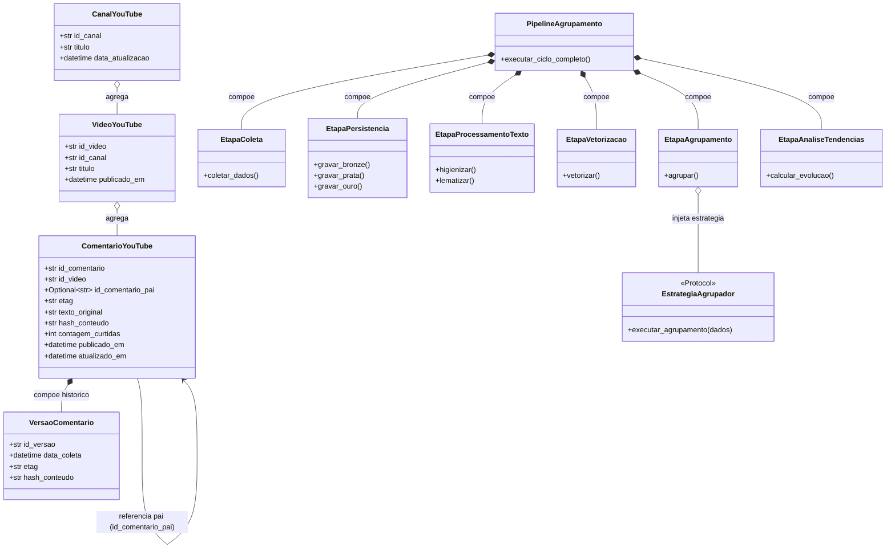

# Plano de Implementação da Arquitetura — Agrupamento de Comentários do YouTube

**Estado:** ✅ **APROVADO PELO USUÁRIO (EXECUÇÃO LIBERADA)**  
**Data da Aprovação:** 2026-10-13  
**Personas Responsáveis:** `@pm` & `@arquiteto`  
**Referência Contratual:** `AGENTS.md`, `rules/`, `specs/`, `config/entradas.yaml`

---

## 1. Visão Geral e Alinhamento de Produto (@pm)

O projeto implementa uma solução corporativa fim-a-fim, estritamente não-LLM, para coleta incremental, higienização, representação vetorial, agrupamento comparativo (KMeans, DBSCAN, HDBSCAN), detecção de tendências temporais e publicação de dados analíticos e de inferência via FastAPI e MLflow.

### 1.1 Entradas de Configuração (`config/entradas.yaml`)
- **Projeto e Idioma:** `pt_BR`, modelo spaCy `pt_core_news_sm`.
- **Coleta:** Habilitada, periodicidade diária, controle de janela retroativa (`dias_publicacao_atras: 7`), coleta exaustiva de respostas (`incluir_respostas: true`), tamanho de página 100, tentativas com backoff (`tentativas: 4`, `atraso_base_segundos: 2`). Chave via variável de ambiente `YOUTUBE_API_KEY`.
- **Processamento:** TF-IDF (`ngram_range: [1, 2]`, `min_df: 2`, `max_df: 0.95`), redução dimensional opcional TruncatedSVD desabilitada por padrão, preservação de negações (`nao`, `nunca`, `sem`).
- **Técnicas de Agrupamento:** KMeans (8 clusters), DBSCAN (eps 0.5, min_samples 5, cosseno), HDBSCAN (min_cluster_size 8, min_samples 5, euclidiana).
- **Extração de Tópicos (Não-LLM):** POS permitidas (`NOUN`, `PROPN`, `ADJ`), comprimento mínimo 3 caracteres, ponderação TF-IDF (0.7) + Frequência (0.3), penalização de termos gerais, exatamente **um lema válido** (ou `sem_topico`).
- **Tendências:** Janela de 7 dias vs janela anterior equivalente, suporte mínimo 5 comentários, limiares de crescimento/queda (+10% / -10%), estados: `novo`, `crescendo`, `decrescendo`, `estavel`, `sem_dados`.
- **Persistência e Serving:** S3/RustFS (bucket `youtube-comentarios`, prefixos `bronze`, `prata`, `ouro`), MLflow tracking e serving, FastAPI porta 8000, Prometheus e Grafana sem rótulos de alta cardinalidade.

### 1.2 Critérios de Aceite Globais
1. **Coleta Completa:** Enumerar vídeos elegíveis do canal e buscar comentários principais (`commentThreads.list`) e todas as respostas filhas via `comments.list(parentId=...)`.
2. **Idempotência e Versionamento:** Reprocessamento diário sem duplicar comentários inalterados; histórico imutável na camada bronze quando `updatedAt`, `etag` ou hash mudarem; snapshot consolidado na prata.
3. **Segregação S3:** Particionamento rigoroso por camada, canal, vídeo e janela temporal. Nenhum dado ou modelo gravado em disco local.
4. **Três Técnicas Comparadas:** KMeans, DBSCAN e HDBSCAN executados de forma independente, com métricas de qualidade (Silhouette, Davies-Bouldin, Calinski-Harabasz, ruído) e consultas segmentadas.
5. **Tópicos Auditáveis:** Rótulo de exatamente uma palavra (lema), com vínculos diretos aos comentários originais e cálculo de crescimento percentual e suporte absoluto.
6. **API Integrada:** FastAPI com endpoints analíticos consumindo camada Ouro e endpoint de inferência (`/v1/inferencias`) operando via Adapter HTTP para o serving do MLflow.
7. **Engenharia Rigorosa:** Tipagem estrita Python 3.12 (`pyright --level strict`), testes automatizados parametrizados (`pytest`), padrões de nomenclatura de duas palavras por módulo e conformidade com o `docker-compose.yaml` existente.

---

## 2. Diagnóstico e Inspeção do Ambiente de Infraestrutura (@devops / @arquiteto)

Foi inspecionada a infraestrutura em execução no Docker Compose raiz (`docker compose ps`):

| Serviço | Imagem | Porta Externa | Estado Inspecionado | Função no Pipeline |
| :--- | :--- | :--- | :--- | :--- |
| **storage** | rustfs/rustfs:1.0.0-alpha.83 | 9000, 9001 | Ativo (healthy) | Gateway S3/MinIO para Data Lake (Bronze, Prata, Ouro) |
| **mlflow-server** | ghcr.io/mlflow/mlflow | 5000 | Ativo (healthy) | Tracking de experimentos, métricas e Registro de Modelos |
| **mlflow-postgres** | postgres:15 | 5432 | Ativo (healthy) | Backend store relacional do MLflow |
| **prometheus** | prom/prometheus:latest | 9090 | Ativo (healthy) | Raspagem e armazenamento de métricas de telemetria |
| **grafana** | grafana/grafana:latest | 3000 | Ativo (healthy) | Painéis de visualização analítica e operacional |
| **loki** | grafana/loki:latest | 3100 | Ativo | Agregação centralizada de logs |
| **alloy** | grafana/alloy:latest | 12345 | Ativo | Coletor de telemetria e traces |

### 2.1 Particularidades Técnicas Validadas no Ambiente
- **RustFS S3:** Requer configuração de endereço explícito `http://127.0.0.1:9000` fora da rede interna do docker e `addressing_style = 'path'` no cliente boto3 para evitar erros de validação de hostname/bucket (`InvalidBucketName`).
- **Bucket `youtube-comentarios`:** Deve ser provisionado programaticamente pelo adaptador de dados caso ainda não exista no RustFS.
- **Python Local (.venv):** Python 3.12.3, pytest 9.1.1 e pyright 1.1.414 prontos e operacionais.
- **Modelo spaCy:** O pacote `pt_core_news_sm` precisará ser baixado na venv (`python -m spacy download pt_core_news_sm`) ou injetado via pipeline de inicialização.

---

## 3. Arquitetura do Sistema e Modelagem de Domínio (@arquiteto)

### 3.1 Modelagem Estrutural UML (Associação, Agregação, Composição)



### 3.2 Contratos e Protocolos Tipados (Python 3.12 Strict, sem `Any`)

Todos os contratos são isolados por interfaces `typing.Protocol` com variância semântica (`TypeVar(..., contravariant=True)`, `TypeVar(..., covariant=True)`), sem uso de `Any`.

```python
# Exemplo estrutural dos contratos tipados

EntradaColeta_contra = TypeVar("EntradaColeta_contra", contravariant=True)
SaidaColeta_co = TypeVar("SaidaColeta_co", covariant=True)

class ProtocoloColetor(Protocol[EntradaColeta_contra, SaidaColeta_co]):
    def coletar_canal(self, parametro: EntradaColeta_contra) -> SaidaColeta_co: ...

EntradaPersistencia_contra = TypeVar("EntradaPersistencia_contra", contravariant=True)
SaidaPersistencia_co = TypeVar("SaidaPersistencia_co", covariant=True)

class ProtocoloRepositorio(Protocol[EntradaPersistencia_contra, SaidaPersistencia_co]):
    def salvar_lote(self, dados: EntradaPersistencia_contra) -> SaidaPersistencia_co: ...
    def consultar_lote(self, identificador: str) -> SaidaPersistencia_co: ...

EntradaAgrupamento_contra = TypeVar("EntradaAgrupamento_contra", contravariant=True)
SaidaAgrupamento_co = TypeVar("SaidaAgrupamento_co", covariant=True)

class ProtocoloAgrupador(Protocol[EntradaAgrupamento_contra, SaidaAgrupamento_co]):
    def ajustar_e_rotular(self, matriz: EntradaAgrupamento_contra) -> SaidaAgrupamento_co: ...
```

---

## 4. Estrutura Canônica de Módulos e Pacotes (`app/` e `tests/`)

De acordo com `rules/01-python-arquitetura.md`, cada pacote e módulo Python próprio possui **exatamente duas palavras separadas por underscore** (exceto `__init__.py` e `__main__.py`):

```text
app/
├── configuracao_geral/
│   ├── __init__.py
│   ├── modelos_configuracao.py         # Modelos dataclass/pydantic tipados de configuração
│   └── provedor_configuracao.py        # Leitor e validador de config/entradas.yaml
├── coleta_youtube/
│   ├── __init__.py
│   ├── cliente_youtube.py              # Wrapper HTTP oficial Google API com quotas e retry
│   ├── extrator_comentarios.py         # Paginação commentThreads e comments.list
│   ├── modelos_coleta.py               # Tipos ComentarioColetado, VideoColetado
│   └── tratador_erros.py               # Exceções QuotaExcedidaErro, VideoIndisponivelErro
├── gestao_dados/
│   ├── __init__.py
│   ├── cliente_s3.py                   # Adaptador boto3 com path-style para RustFS
│   ├── camada_bronze.py                # Ingestão imutável JSONL particionada
│   ├── camada_prata.py                 # Transformação e snapshot Parquet
│   ├── camada_ouro.py                  # Publicação de tópicos e tendências agregadas
│   └── controle_idempotencia.py        # Checagem de etag, updatedAt e hash SHA256
├── tratamento_texto/
│   ├── __init__.py
│   ├── limpador_texto.py               # Remoção de links/tags preservando texto original
│   ├── lematizador_spacy.py            # Tokenização, lematização e preservação de negações
│   └── rotulador_topicos.py            # Extração de 1 lema com POS/TF-IDF/frequência
├── representacao_texto/
│   ├── __init__.py
│   ├── vetorizador_tfidf.py            # Estratégia TF-IDF configurável
│   ├── redutor_dimensionalidade.py     # TruncatedSVD opcional
│   └── fabrica_representacao.py        # Factory de estratégias de vetorização
├── agrupamento_modelos/
│   ├── __init__.py
│   ├── agrupador_kmeans.py             # Strategy KMeans com persistência de centróides
│   ├── agrupador_dbscan.py             # Strategy DBSCAN com tratamento de ruído (-1)
│   ├── agrupador_hdbscan.py            # Strategy HDBSCAN com probabilidades
│   ├── avaliador_qualidade.py          # Silhouette, Davies-Bouldin, Calinski-Harabasz
│   └── fabrica_agrupadores.py          # Factory de algoritmos de clustering
├── analise_tendencias/
│   ├── __init__.py
│   ├── calculador_tendencias.py        # Comparador temporal janela atual vs anterior
│   ├── detector_variacao.py            # Classificador: novo, crescendo, decrescendo, estavel
│   └── agregador_visoes.py             # Consolidador por vídeo e por canal
├── integracao_mlflow/
│   ├── __init__.py
│   ├── rastreador_experimentos.py      # Log de parâmetros, métricas e manifesto S3
│   ├── registro_modelos.py             # Versionamento e tags de homologação
│   └── adaptador_serving.py            # Cliente HTTP para endpoint /invocations do MLflow
├── servico_api/
│   ├── __init__.py
│   ├── aplicacao_fastapi.py            # App FastAPI, middlewares e lifespan
│   ├── rotas_canais.py                 # GET /v1/canais/{id_canal}/tendencias
│   ├── rotas_videos.py                 # GET .../videos/{id_video}/clusters e /tendencias
│   ├── rotas_inferencias.py            # POST /v1/inferencias (adapter MLflow)
│   └── esquemas_respostas.py           # Schemas tipados de requisição e resposta
├── coleta_metricas/
│   ├── __init__.py
│   ├── medidor_coleta.py               # Contadores de comentários, páginas, quotas
│   ├── medidor_modelos.py              # Métricas de tempo, ruído e clusters
│   └── middleware_prometheus.py        # Middleware HTTP de latência e contagem
└── orquestracao_pipeline/
    ├── __init__.py
    ├── executor_ciclo.py               # Orquestrador sequencial diário do pipeline
    └── despachante_alertas.py          # Emissão de eventos e logs operacionais

tests/
├── conftest.py                         # Fixtures sintéticas de canais, vídeos e comentários
├── teste_configuracao.py               # Validação de carregamento do YAML
├── teste_coleta.py                     # Coleta com paginação e respostas com parentId
├── teste_idempotencia.py               # Regras de etag, hash e versionamento bronze/prata
├── teste_nlp.py                        # Lematização, negações e extração de 1 lema
├── teste_clusters.py                   # KMeans, DBSCAN e HDBSCAN com métricas e ruído
├── teste_tendencias.py                 # Janelas temporais, divisão por zero e suporte mínimo
├── teste_contratos.py                  # Schemas de API, resposta ouro e adapter MLflow
├── teste_api.py                        # Testes funcionais dos endpoints FastAPI
└── teste_metricas.py                   # Validação de instrumentação do Prometheus
```

---

## 5. Layout do Data Lake e Estratégia de Particionamento (S3/RustFS)

Nenhum arquivo de dados será gravado em disco local. O pipeline utiliza o bucket `youtube-comentarios` no S3/RustFS:

1. **Camada Bronze (Histórico Imutável Bruto):**
   - Chave: `bronze/id_canal={id_canal}/id_video={id_video}/data_coleta={YYYY-MM-DD}/lote={uuid}.jsonl`
   - Armazena a resposta bruta enriquecida com metadados de coleta (`data_coleta`, `versao_hash`, `etag`).
2. **Camada Prata (Estado Atual Higienizado e Tipado):**
   - Chave: `prata/id_canal={id_canal}/id_video={id_video}/versao={timestamp}/comentarios.parquet`
   - Deduplicado por `id_comentario`, preservando texto original e colunas lematizadas, com hierarquia `id_comentario_pai`.
3. **Camada Ouro (Agregados Analíticos e Tópicos):**
   - Visão Vídeo: `ouro/id_canal={id_canal}/id_video={id_video}/tecnica={kmeans|dbscan|hdbscan}/janela={periodo}/topicos.parquet`
   - Visão Canal: `ouro/id_canal={id_canal}/consolidado/tecnica={kmeans|dbscan|hdbscan}/janela={periodo}/topicos.parquet`
   - Estrutura de tópicos: `topico` (1 lema), `contagem_atual`, `contagem_anterior`, `variacao_percentual`, `status_tendencia`, `ids_comentarios_amostra`.

---

## 6. Algoritmos de NLP, Agrupamento e Tendências (Não-LLM)

### 6.1 Regras de Extração de Tópicos
- Processamento com spaCy pt-BR com preservação explícita de `nao`, `nunca`, `sem`.
- Limpeza sem remoção do texto original (URLs, menções removidas do texto processado).
- Candidatos a tópico: tokens únicos com POS `NOUN`, `PROPN` ou `ADJ`, tamanho >= 3, excluindo stopwords.
- Rótulo final do cluster: cálculo do lema que maximiza $Score = 0.7 \times TFIDF_{médio} + 0.3 \times Frequência_{relativa} \times Penalidade_{geral}$.
- Caso nenhum lema atinja o suporte mínimo: rotulado como `sem_topico`.

### 6.2 Agrupamento Comparativo
- **KMeans:** 8 clusters (configurável), centróides calculados, métricas completas.
- **DBSCAN:** Métrica de cosseno sobre TF-IDF, detecção de outliers rotulados com `-1`.
- **HDBSCAN:** Agrupamento baseado em densidade hierárquica, separação explícita de ruído.
- Métricas auditadas no MLflow: Silhouette (quando $> 1$ cluster não-ruído), Davies-Bouldin, Calinski-Harabasz e Proporção de Ruído.

### 6.3 Análise de Tendências
- Cálculo sobre janelas temporais contíguas de igual duração (7 dias atuais vs 7 dias anteriores).
- Suporte mínimo de comentários para cálculo ($N \ge 5$).
- Classificação estrita:
  - `novo`: contagem anterior $= 0$ e contagem atual $\ge$ suporte mínimo.
  - `crescendo`: crescimento percentual $> +10\%$.
  - `decrescendo`: redução percentual $< -10\%$.
  - `estavel`: variação entre $[-10\%, +10\%]$.
  - `sem_dados`: dados insuficientes para a janela.

---

## 7. MLOps, Serving e Observabilidade

- **MLflow Tracking:** Registro de todas as execuções (`runs`), parâmetros de cada técnica, artefatos de modelo serializados e manifesto de dados vinculando o bucket S3.
- **FastAPI / Serving:** A API expõe consultas analíticas diretas à camada Ouro e rota `POST /v1/inferencias` delegando via HTTP Adapter ao endpoint de serving do MLflow.
- **Prometheus Metrics:**
  - `youtube_coleta_comentarios_total`: Total de comentários processados.
  - `youtube_coleta_erros_total`: Erros de quota, rate limit ou rede.
  - `youtube_cluster_ruido_razao`: Fração de ruído por técnica.
  - `youtube_pipeline_duracao_segundos`: Duração de cada etapa do pipeline.
  - Nenhuma métrica conterá rótulos de alta cardinalidade (`id_video` ou `id_comentario`).

---

## 8. Matriz de Riscos e Estratégias de Mitigação

| Risco Identificado | Severidade | Impacto | Estratégia de Mitigação |
| :--- | :--- | :--- | :--- |
| **Quota da API do YouTube excedida (403/429)** | Alta | Interrupção da coleta diária | Uso prioritário de `playlistItems.list`, controle de paginação, backoff exponencial e suporte a mock offline em ambiente de teste |
| **RustFS S3 Host Header / Path Style** | Média | Falha de conexão com o lakehouse | Forçar `addressing_style: path` e endpoint `http://127.0.0.1:9000` no cliente S3 |
| **Modelo spaCy ausente no container/local** | Média | Erro na etapa de NLP | Tratamento de carregamento com download automático do modelo `pt_core_news_sm` e mocks sintéticos em testes unitários |
| **Degradação de Qualidade em Clusters Vazios** | Média | Erro no cálculo de Silhouette | Guarda defensiva que valida existência de mais de 1 cluster antes de executar métricas internas de distância |
| **Violação de Tipagem Estrita (Pyright)** | Baixa | Bloqueio no QA | Protocolos genéricos estritos, tipos expressos sem `Any`, uso de TypedDict e dataclasses |

---

## 9. Plano de Execução por Fases Sequenciais

Após a aprovação deste plano, as fases serão executadas sequencialmente conforme as personas de trabalho:

1. **Fase 1 (@coleta):** Implementação de `app/coleta_youtube/` e testes unitários com fixtures offline de respostas e paginação.
2. **Fase 2 (@datalake):** Implementação de `app/gestao_dados/` (S3 RustFS, camadas bronze, prata e controle de idempotência/versões).
3. **Fase 3 (@nlp):** Implementação de `app/tratamento_texto/` e `app/representacao_texto/` (spaCy, TF-IDF, negações e tópicos de 1 lema).
4. **Fase 4 (@clusterizacao):** Implementação de `app/agrupamento_modelos/` (KMeans, DBSCAN, HDBSCAN, ruído e avaliação).
5. **Fase 5 (@tendencias):** Implementação de `app/analise_tendencias/` e persistência da camada ouro.
6. **Fase 6 (@mlflow):** Implementação de `app/integracao_mlflow/` (experimentos, métricas, manifesto S3 e adapter serving).
7. **Fase 7 (@api):** Implementação de `app/servico_api/` (FastAPI com rotas de canais, vídeos, tópicos e inferências).
8. **Fase 8 (@observabilidade):** Implementação de `app/coleta_metricas/` (Prometheus metrics e middlewares).
9. **Fase 9 (@qa):** Execução da suíte completa de testes (`pytest`), validação estrita do type checker (`pyright`) e testes de contrato.
10. **Fase 10 (@devops / Final):** Consolidação de `production_artifacts/startcycle_entrega.md` com evidências reais e encerramento do ciclo.

---

---

## 11. Adendo — Otimização Automática do Número de Clusters no KMeans e MLflow (@clusterizacao & @mlflow)

**Estado:** 🟡 **AGUARDANDO APROVAÇÃO DO USUÁRIO**  
**Data:** 2026-10-13  
**Objetivo:** Permitir que o algoritmo KMeans determine autonomamente o melhor $k$ (número de clusters) baseado em Silhouette Score e registre tanto os artefatos treinados quanto as métricas de otimização no MLflow Tracking/Registry.

### 11.1 Especificação Técnica de Seleção de $k$ Ótimo
1. **Critério Determinístico:** Varredura em intervalo $k \in [k_{\min}, \min(k_{\max}, N - 1)]$, onde $N$ é o número de amostras (comentários vetorizados).
2. **Métricas de Seleção:**
   - Cálculo do **Silhouette Score** para cada partição candidata ($k \ge 2$).
   - Fallback defensivo para $k=1$ ou $k=N$ quando $N < 3$ ou quando a variabilidade dos dados for nula.
   - Critério de desempate via **Calinski-Harabasz Index** e **Davies-Bouldin Index**.
3. **Parâmetros Configuráveis em `config/entradas.yaml`:**
   ```yaml
   processamento:
     tecnicas:
       kmeans:
         ativo: true
         parametros:
           n_clusters: 8
           random_state: 42
           n_init: 10
           k_automatico: true
           k_min: 2
           k_max: 10
   ```
4. **Persistência de Artefato e Métricas no MLflow:**
   - **Métricas registradas:** `k_otimo`, `silhueta_k_otimo`, curvas de silhueta para cada $k$ avaliado.
   - **Artefatos de Modelo:** Serialização do modelo scikit-learn treinado com o melhor $k$ via `mlflow.sklearn.log_model(sk_model=modelo, artifact_path="modelo_kmeans")`.
   - **Model Registry:** Registro formal da versão gerada no MLflow Model Registry sob o nome `modelo_kmeans_youtube`.

### 11.2 Módulos Envolvidos
- `config/entradas.yaml`: Adição das chaves `k_automatico`, `k_min`, `k_max` em `parametros`.
- `app/configuracao_geral/modelos_configuracao.py`: Atualização de `ParametrosKMeans` com validação de limites Pydantic.
- `app/agrupamento_modelos/agrupador_kmeans.py`: Implementação da lógica de busca em grid/avaliação de silhueta e exposição do modelo scikit-learn treinado.
- `app/integracao_mlflow/rastreador_experimentos.py`: Suporte a salvamento de artefatos de modelo scikit-learn (`mlflow.sklearn.log_model`).
- `app/orquestracao_pipeline/executor_ciclo.py`: Passagem do modelo ajustado e das métricas de otimização para o rastreador MLflow.
- `tests/teste_clusters.py` & `tests/teste_mlflow.py`: Testes unitários cobrindo seleção com dados sintéticos e log de modelo no MLflow.

### 11.3 Critérios de Aceite
1. O KMeans escolhe o $k$ com maior Silhouette Score no intervalo $[k_{\min}, k_{\max}]$.
2. Se $k\_automatico=false$, o comportamento anterior com `n_clusters` fixo é estritamente mantido.
3. O modelo scikit-learn é gravado como artefato da run no MLflow Tracking.
4. Cobertura de 100% dos cenários em testes automatizados (`pytest`).
5. Zero erros no Pyright em modo strict (`pyright --level strict`).

---

---

## 12. Adendo 2 — Extração Semântica de Centróides e Endpoint REST (`@api` & `@clusterizacao`)

**Estado:** 🟡 **AGUARDANDO APROVAÇÃO DO USUÁRIO**  
**Data:** 2026-10-14  
**Objetivo:** Expor via API REST a riqueza semântica contida nos centróides do KMeans (top termos ponderados por cluster, densidade, dispersão e comentário exemplar protótipo).

### 12.1 O que Será Extraído dos Centróides
1. **Top Termos mais Características do Centróide:** Extração dos $N$ termos (lemas) com maiores valores de peso TF-IDF no vetor do centróide de cada cluster, revelando a identidade temática central.
2. **Comentário Protótipo (Medoide / Exemplar Central):** Identificação do comentário real com menor distância euclidiana/cosseno até o centróide.
3. **Distribuição e Volume do Cluster:** Contagem absoluta e percentual de comentários orbitando o centróide.

### 12.2 Especificação do Novo Endpoint da API
- **Método & Rota:** `GET /v1/canais/{id_canal}/videos/{id_video}/centroides`
- **Query Parameters:**
  - `tecnica: TecnicaCluster` (padrão: `kmeans`)
  - `janela: JanelaTemporal` (padrão: `7dias`)
  - `top_termos_limite: int` (padrão: 5, ge: 1, le: 20)
- **Modelos de Resposta (Pydantic v2):**
  - `TermoCentroide`: `termo: str`, `peso: float`
  - `DetalheCentroide`: `cluster_id: int`, `rotulo_topico: str`, `total_comentarios: int`, `top_termos: list[TermoCentroide]`, `comentario_exemplar: str | None`
  - `RespostaCentroidesVideo`: `id_canal: str`, `id_video: str`, `tecnica: TecnicaCluster | str`, `janela: JanelaTemporal | str`, `total_clusters: int`, `centroides: list[DetalheCentroide]`

### 12.3 Módulos Envolvidos
- `app/servico_api/esquemas_respostas.py`: Criação dos esquemas `TermoCentroide`, `DetalheCentroide` e `RespostaCentroidesVideo`.
- `app/servico_api/rotas_videos.py`: Implementação da rota `GET /{id_video}/centroides`.
- `tests/teste_api.py`: Testes unitários com TestClient validando status 200, parâmetros e schema.
- `docs/index.html`: Inclusão do novo endpoint na documentação e tabela de rotas.

## 13. Adendo 3 — Busca de Centróides por Canal e por Vídeo (`@api` & `@datalake`)

**Estado:** ✅ **APROVADO PELO USUÁRIO (EXECUÇÃO LIBERADA)**  
**Data da Aprovação:** 2026-10-14  
**Objetivo:** Permitir a busca de centróides tanto em nível de canal (visão consolidada de tópicos do canal) quanto filtrada por vídeo opcional (`id_video`), além de preservar a rota direta por vídeo.

### 13.1 Arquitetura e Rota de Consulta
- **Endpoint Principal:** `GET /v1/canais/{id_canal}/centroides`
- **Query Parameters:**
  - `id_video: str | None = Query(None, description="Identificador opcional de vídeo. Se informado, extrai centróides do vídeo; se omitido, extrai do consolidado do canal")`
  - `tecnica: TecnicaCluster` (padrão: `kmeans`)
  - `janela: JanelaTemporal` (padrão: `7dias`)
  - `top_termos_limite: int` (padrão: 5, ge: 1, le: 20)
- **Comportamento de Resolução de Dados na Camada Ouro (S3):**
  - **Quando `id_video` é fornecido:** Consulta `ouro/id_canal={id_canal}/id_video={id_video}/tecnica={tecnica}/janela={janela}/topicos.parquet`
  - **Quando `id_video` é omitido:** Consulta `ouro/id_canal={id_canal}/consolidado/tecnica={tecnica}/janela={janela}/topicos.parquet`
- **Rota Específica Existente:** Mantém-se `GET /v1/canais/{id_canal}/videos/{id_video}/centroides` intacta para consultas diretas na hierarquia REST de vídeos.

### 13.2 Esquema de Resposta Pydantic
- **Esquema:** `RespostaCentroidesCanal`:
  ```python
  class RespostaCentroidesCanal(BaseModel):
      id_canal: str
      id_video: str | None = None
      tecnica: TecnicaCluster | str
      janela: JanelaTemporal | str
      total_clusters: int
      centroides: list[DetalheCentroide]
  ```

### 13.3 Módulos Envolvidos
1. `app/servico_api/esquemas_respostas.py`: Adicionar `RespostaCentroidesCanal`.
2. `app/servico_api/rotas_canais.py`: Implementar `GET /{id_canal}/centroides` com parâmetro `id_video`.
3. `tests/teste_api.py`: Testes com e sem `id_video`, validando status 200, filtro correto e campos de resposta.
4. `docs/index.html`: Documentação da nova rota na tabela de rotas e exemplos interativos de chamada via cURL / Python.

---

## 14. Adendo 4 — Externalização e Parametrização Completa via Arquivo YAML (`@arquiteto` & `@devops`)

**Estado:** ✅ **APROVADO PELO USUÁRIO (EXECUÇÃO LIBERADA)**  
**Data da Aprovação:** 2026-10-14  
**Objetivo:** Eliminar parâmetros fixos (*hardcoded*) no código, permitindo que comportamentos de NLP, extração de tópicos, agrupamento, tendências e limites da API sejam configurados dinamicamente via `config/entradas.yaml` com 100% de retrocompatibilidade.

### 14.1 Novos Parâmetros Mapeados no `config/entradas.yaml`
1. **Representação TF-IDF (`processamento.representacao`):**
   - `sublinear_tf: bool = true` (escala logarítmica para $TF$)
   - `norma: str = "l2"` (normalização de norma de vetor: `"l1"`, `"l2"` ou `null`)
2. **Stopwords e Filtro de Centróides (`processamento.stopwords`):**
   - `filtro_centroides: list[str]` (palavras excluídas da extração de top termos dos centróides)
3. **Extração de Tópicos (`topicos`):**
   - `limiar_penalizacao_global: float = 0.75` (fração de documentos para considerar palavra onipresente)
   - `fator_penalidade: float = 0.2` (multiplicador de atenuação de score)
   - `rotulo_ruido_padrao: str = "sem_topico"` (rótulo para clusters sem suporte ou dispersos)
4. **Análise de Tendências (`tendencias`):**
   - `max_amostras_video: int = 5` (amostras salvas por tópico no vídeo)
   - `max_amostras_canal: int = 10` (amostras salvas no consolidado do canal)
5. **Agrupadores (`processamento.tecnicas`):**
   - KMeans: `max_iter: int = 300`
   - DBSCAN: `algorithm: str = "auto"`
   - HDBSCAN: `cluster_selection_method: str = "eom"`
6. **API REST (`api`):**
   - `cors_origens: list[str] = ["*"]`
   - `top_termos_padrao: int = 5`
   - `tamanho_pagina_padrao: int = 10`
   - `tamanho_pagina_maximo: int = 100`

### 14.2 Módulos Envolvidos
- `config/entradas.yaml`: Inclusão dos novos parâmetros com valores padrão e comentários explicativos.
- `app/configuracao_geral/modelos_configuracao.py`: Atualização dos dataclasses tipados (`ConfiguracaoRepresentacao`, `ConfiguracaoStopwords`, `ConfiguracaoTopicos`, `ConfiguracaoTendencias`, `ParametrosKMeans`, `ParametrosDBSCAN`, `ParametrosHDBSCAN`, `ConfiguracaoAPI`).
- `app/configuracao_geral/provedor_configuracao.py`: Leitura das novas chaves com valores de fallback idênticos aos anteriores.
- `app/representacao_texto/vetorizador_tfidf.py` & `fabrica_representacao.py`: Injeção de `sublinear_tf` e `norma`.
- `app/tratamento_texto/rotulador_topicos.py`: Uso de `limiar_penalizacao_global`, `fator_penalidade` e `rotulo_ruido_padrao`.
- `app/analise_tendencias/calculador_tendencias.py` & `agregador_visoes.py`: Uso de `max_amostras_video` e `max_amostras_canal`.
- `app/agrupamento_modelos/`: Injeção dos novos parâmetros em `AgrupadorKMeans`, `AgrupadorDBSCAN` e `AgrupadorHDBSCAN`.
- `app/servico_api/`: Uso dos limites e stopwords de centróides configurados.
- `tests/teste_configuracao.py`: Testes unitários para validar o carregamento dos novos parâmetros e os valores padrão de fallback.
- `docs/index.html` & `README.md`: Atualização da documentação com o modelo de configuração expandido.

---

## 15. Adendo 5 — Protocolos Estruturais (Interfaces) no `ExecutorCiclo` e Inversão de Dependências (`@arquiteto`)

**Estado:** ✅ **APROVADO PELO USUÁRIO (EXECUÇÃO LIBERADA)**  
**Data da Aprovação:** 2026-10-14  
**Objetivo:** Introduzir interfaces de protocolo (`typing.Protocol` com `@runtime_checkable`) na orquestração do pipeline, tornando a classe `ExecutorCiclo` desacoplada de implementações concretas e flexível para novos executores, mocks e pipelines alternativos (DIP - Dependency Inversion Principle).

### 15.1 Componentes e Protocolos Estruturais
1. **Interface do Executor (`ProtocoloExecutorCiclo`):**
   - Protocolo estrutural verificável em tempo de execução (`@runtime_checkable`).
   - Define o contrato do método de disparo:
     ```python
     def executar_ciclo_canal(self, id_canal: str) -> dict[str, int]: ...
     ```
   - Permite criar executores alternativos (ex: mock para testes rápidos, executor assíncrono ou executor com instrumentação customizada) sem alterar consumidores ou scripts.
2. **Interfaces das Dependências de Orquestração:**
   - `ProtocoloExtrator`: interface para extração incremental de comentários.
   - `ProtocoloCamadasLakehouse`: interfaces para `CamadaBronze`, `CamadaPrata` e `CamadaOuro`.
   - `ProtocoloProcessamentoTexto`: interfaces para lematização e rotulagem de tópicos.
   - `ProtocoloTendencias`: interfaces para cálculo e agregação de visões temporais.
   - O construtor de `ExecutorCiclo` passa a aceitar os protocolos estruturais correspondentes, mantendo compatibilidade direta e transparente com as classes existentes.

### 15.2 Módulos Envolvidos
1. `app/orquestracao_pipeline/executor_ciclo.py`:
   - Declaração de `ProtocoloExecutorCiclo` com `@runtime_checkable`.
   - Tipagem flexível das dependências do `__init__` via protocolos estruturais.
   - Implementação natural de `ProtocoloExecutorCiclo` pela classe `ExecutorCiclo`.
2. `app/orquestracao_pipeline/__init__.py`:
   - Exportação de `ProtocoloExecutorCiclo` e `ExecutorCiclo`.
3. `tests/teste_contratos.py`:
   - Teste unitário verificando que `isinstance(executor, ProtocoloExecutorCiclo)` é `True`.
   - Teste de flexibilidade demonstrando a instanciação de um executor com dublês de teste (mocks) estruturais.
4. `docs/index.html` & `README.md`:
   - Documentação da interface `ProtocoloExecutorCiclo` na seção de padrões de projeto e arquitetura de módulos.

---

## 16. Adendo 6 — Correção e Robustez do Serviço de Storage (RustFS S3 e Lakehouse) (`@devops` / `@arquiteto`)

**Estado:** ✅ **APROVADO PELO USUÁRIO (EXECUÇÃO LIBERADA)**  
**Data da Aprovação:** 2026-10-14  
**Objetivo:** Corrigir a configuração do serviço `storage` (RustFS) e seu provisionador no `docker-compose.yaml`, ajustar o adaptador `ClienteS3` para máxima resiliência e assegurar o provisionamento automático do bucket `youtube-comentarios`.

### 16.1 Diagnóstico das Falhas Identificadas no Storage
1. **Restrição Indevida de Domínios (`RUSTFS_SERVER_DOMAINS`):**
   - O `docker-compose.yaml` define `RUSTFS_SERVER_DOMAINS: storage:9000`. No RustFS, essa variável ativa o modo de virtual-hosting estrito para o domínio especificado.
   - Ao acessar o serviço a partir do host externo ou de scripts locais via `http://localhost:9000` ou `http://127.0.0.1:9000`, o RustFS interpreta o cabeçalho `Host` como o nome de um bucket, disparando `InvalidBucketName` ou `400 Bad Request`.
   - **Solução:** Remover a variável `RUSTFS_SERVER_DOMAINS` do container `storage`, permitindo que o RustFS opere universalmente no padrão path-style (`addressing_style: path`) tanto internamente (`http://storage:9000`) quanto externamente (`http://localhost:9000` / `http://127.0.0.1:9000`).
2. **Provisionamento do Bucket Lakehouse (`create-bucket`):**
   - O serviço `create-bucket` atualmente cria apenas o `mlflow-bucket`.
   - O bucket do Lakehouse (`youtube-comentarios`) não é provisionado automaticamente na inicialização da stack Docker.
   - **Solução:** Atualizar o script de entrada do `create-bucket` para iterar e criar de forma idempotente tanto o bucket do MLflow quanto o bucket de comentários (`youtube-comentarios`).
3. **Resiliência do Adaptador `ClienteS3` (`app/gestao_dados/cliente_s3.py`):**
   - O método `garantir_bucket_existente` verifica `erro.response.get("Error", {}).get("Code") in ("404", "NoSuchBucket", 404)`.
   - Em chamadas `head_bucket` do botocore contra gateways compatíveis com S3 (como RustFS e MinIO), respostas HTTP 404 não possuem corpo XML e podem não preencher `Error.Code`, mantendo apenas `ResponseMetadata.HTTPStatusCode == 404`.
   - **Solução:** Validar também se `HTTPStatusCode == 404`, garantindo a criação programática do bucket caso o gateway retorne 404 sem corpo.
4. **Alinhamento do Arquivo `.env`:**
   - Adicionar as variáveis `S3_ENDPOINT_URL=http://127.0.0.1:9000` e `DATA_BUCKET=youtube-comentarios` no `.env`.

### 16.2 Módulos e Arquivos Impactados
- `docker-compose.yaml`: Remoção de `RUSTFS_SERVER_DOMAINS` no `storage` e inclusão do bucket `youtube-comentarios` no loop de criação do `create-bucket`.
- `app/gestao_dados/cliente_s3.py`: Inclusão de verificação de `HTTPStatusCode == 404` em `garantir_bucket_existente`.
- `.env`: Inclusão de `S3_ENDPOINT_URL` e `DATA_BUCKET`.
- `tests/teste_idempotencia.py` & `tests/teste_contratos.py`: Verificação de estabilidade em testes unitários e de integração.
- `docs/index.html` & `README.md`: Atualização das notas de arquitetura sobre o acesso híbrido (interno/externo) ao RustFS S3.

---

## 18. Adendo 7 — Extração de Protocolos de Orquestração para Módulo Dedicado (`protocolos_ciclo.py`) (`@arquiteto`)

**Estado:** ✅ **APROVADO PELO USUÁRIO (EXECUÇÃO LIBERADA)**  
**Data da Aprovação:** 2026-10-14  
**Objetivo:** Desacoplar os contratos estruturais (`typing.Protocol`) do módulo de execução concreta, movendo todos os protocolos de `executor_ciclo.py` para um novo módulo dedicado `app/orquestracao_pipeline/protocolos_ciclo.py`, mantendo a regra canônica de nomenclatura de duas palavras (`<termo1>_<termo2>.py`).

### 18.1 Justificativa Arquitetural
- **Princípio da Responsabilidade Única (SRP):** Manter contratos e interfaces separados da lógica de execução operacional do pipeline.
- **Evitar Acoplamento Circular e Melhorar Reutilização:** Permite que outros módulos, mocks, testes e implementações alternativas importem diretamente os protocolos sem carregar dependências pesadas de `ExecutorCiclo`.
- **Conformidade com Padrões do Projeto:** O novo arquivo `protocolos_ciclo.py` cumpre estritamente a convenção de duas palavras em snake_case.

### 18.2 Protocolos Movidos para `app/orquestracao_pipeline/protocolos_ciclo.py`
- `ProtocoloExecutorCiclo`
- `ProtocoloExtratorComentarios`
- `ProtocoloCamadaBronze`
- `ProtocoloCamadaPrata`
- `ProtocoloCamadaOuro`
- `ProtocoloLematizador`
- `ProtocoloRotuladorTopicos`
- `ProtocoloCalculadorTendencias`
- `ProtocoloAgregadorVisoes`
- `ProtocoloRastreadorExperimentos`

### 18.3 Impacto nos Módulos Existentes
- `app/orquestracao_pipeline/protocolos_ciclo.py`: Criação do novo módulo contendo todas as interfaces `Protocol` com `@runtime_checkable`.
- `app/orquestracao_pipeline/executor_ciclo.py`: Remoção dos blocos de definição de protocolos e importação de `protocolos_ciclo.py`.
- `app/orquestracao_pipeline/__init__.py`: Exportação de `ProtocoloExecutorCiclo` a partir de `protocolos_ciclo.py`.
- `tests/teste_contratos.py`: Verificação de importação e validação de `isinstance` com o novo módulo.
- `docs/index.html` & `README.md`: Atualização da tabela de módulos e referências.

---

## 20. Adendo 8 — Padronização Universal do Fuso Horário Brasileiro (`America/Sao_Paulo`) no Docker Compose (`@devops`)

**Estado:** ✅ **APROVADO PELO USUÁRIO (EXECUÇÃO LIBERADA)**  
**Data da Aprovação:** 2026-10-14  
**Objetivo:** Garantir que todos os containers da infraestrutura Docker operem de forma sincronizada sob o fuso horário oficial de Brasília (`America/Sao_Paulo`, UTC-3), tanto via variável de ambiente `TZ` quanto via montagem dos arquivos do sistema do host (`/etc/localtime` e `/etc/timezone`), cobrindo imagens mínimas e distroless.

### 20.1 Diagnóstico
- Embora a variável `TZ: America/Sao_Paulo` estivesse declarada em serviços Python/Postgres, imagens distroless e mínimas como `storage` (RustFS) e `prometheus` não incluem `tzdata`, mantendo o relógio interno em UTC (`Thu Oct 15 00:37:33 UTC 2026`).
- Para garantir paridade absoluta entre todos os serviços (Postgres, Storage RustFS, Bucket Creator, MLflow Server, MLflow Serving, Prometheus, Grafana, Loki, Alloy e FastAPI), é mandatório o bind-mount dos arquivos de timezone do host Linux (`/etc/localtime` e `/etc/timezone` em modo `:ro`).

### 20.2 Modificações Planejadas
1. **`docker-compose.yaml`:**
   - Adicionar bind-mount de `/etc/localtime:/etc/localtime:ro` e `/etc/timezone:/etc/timezone:ro` nos serviços da stack: `storage`, `postgres`, `create-bucket`, `mlflow`, `prometheus`, `grafana`, `loki`, `alloy`, `mlflow-serving` e `api`.
   - Padronizar a variável de ambiente `TZ: ${TZ:-America/Sao_Paulo}` em todos os containers.
2. **`.env`:**
   - Adicionar `TZ=America/Sao_Paulo` no topo do arquivo para parametrização centralizada.
3. **Validação Operacional:**
   - Executar `docker compose up -d` para atualizar os containers afetados.
   - Validar com `docker exec <container> date` que todos os serviços exibem o timezone `-03` correspondente ao horário brasileiro.

---

## 22. Adendo 9 — Geração de `.gitignore` Robusto e Abrangente (`@devops`)

**Estado:** ✅ **APROVADO PELO USUÁRIO (EXECUÇÃO LIBERADA)**  
**Data da Aprovação:** 2026-10-14  
**Objetivo:** Gerar um arquivo `.gitignore` de nível corporativo protegendo segredos, dados persistidos de containers Docker, caches de ferramentas de build e tipagem, artefatos de modelos e garantindo conformidade com a política de zero persistência de dados no repositório.

### 22.1 Categorias Cobertas no `.gitignore`
1. **Segredos e Credenciais:**
   - `.env`, `youtube.env`, `*.env` (exceto `.env.example`).
   - Chaves de API e arquivos de credenciais AWS/GCP.
2. **Ambientes Virtuais e Dependências:**
   - `.venv/`, `env/`, `venv/`, `ENV/`.
   - `build/`, `dist/`, `*.egg-info/`, `eggs/`.
3. **Caches de Interpretador e Linters:**
   - `__pycache__/`, `*.py[cod]`, `*$py.class`.
   - `.pytest_cache/`, `.mypy_cache/`, `.ruff_cache/`, `.pyright/`.
   - `.coverage`, `htmlcov/`.
4. **Volumes de Dados Docker da Stack Local:**
   - `pgdata/`, `storage-data/`, `grafana_data/`, `prometheus_data/`, `observabilidade_data/`.
5. **Dados de Lakehouse e Modelos (Zero Local Disk):**
   - `*.parquet`, `*.jsonl`, `*.pkl`, `*.joblib`, `*.pt`, `*.onnx`.
   - `mlruns/`, `mlartifacts/`.
6. **IDEs e Sistema Operacional:**
   - `.idea/`, `.vscode/`, `*.swp`, `*.swo`.
   - `.DS_Store`, `Thumbs.db`.

### 22.2 Módulos e Arquivos Impactados
- `.gitignore`: Atualização com todas as seções estruturadas e documentadas.

---

## 24. Adendo 10 — Configuração de Usuário e Senha Dedicados para o RustFS / S3 (`@devops`)

**Estado:** ✅ **APROVADO PELO USUÁRIO (EXECUÇÃO LIBERADA)**  
**Data da Aprovação:** 2026-10-14  
**Objetivo:** Substituir as credenciais genéricas/padrão (`s3admin`/`s3admin`) por um par de credenciais corporativas dedicadas (`AWS_ACCESS_KEY_ID` e `AWS_SECRET_ACCESS_KEY`), atualizando o serviço de Storage, a autenticação da Console WebUI (porta 9001), o provisionador de buckets e todos os clientes integrados (MLflow, Serving e FastAPI).

### 24.1 Credenciais Propostas
- **Usuário / Access Key:** `rustfs_admin`
- **Senha / Secret Key:** `RustFS@2026Admin` (com suporte a customização via `.env`)

### 24.2 Arquivos Impactados e Ações
1. **`.env` e `.env.example`:**
   - Atualizar `AWS_ACCESS_KEY_ID=rustfs_admin` e `AWS_SECRET_ACCESS_KEY=RustFS@2026Admin`.
2. **`docker-compose.yaml`:**
   - Atualizar os fallbacks padrão nos serviços `storage`, `create-bucket`, `mlflow`, `mlflow-serving` e `api-fastapi` para `${AWS_ACCESS_KEY_ID:-rustfs_admin}` e `${AWS_SECRET_ACCESS_KEY:-RustFS@2026Admin}`.
3. **`app/gestao_dados/cliente_s3.py`:**
   - Atualizar os valores padrão de fallback no construtor do `ClienteS3`.
4. **Reinicialização e Validação Operacional:**
   - Reiniciar o container `storage` com as novas credenciais.
   - Reexecutar o provisionamento e validar chamadas `boto3` e `ClienteS3` com o novo usuário e senha.

---

## 26. Adendo 11 — Provisionamento Declarativo dos Dashboards Grafana (`@observabilidade`)

**Estado:** ✅ **APROVADO PELO USUÁRIO (EXECUÇÃO LIBERADA)**  
**Data do Adendo:** 2026-10-14  
**Objetivo:** Criar e provisionar dashboards declarativos em JSON dentro de `config_ob/dashboards/` para visualização em tempo real de telemetria da ingestão YouTube, qualidade dos modelos comparativos (KMeans, DBSCAN, HDBSCAN), métricas de performance da FastAPI e logs centralizados via Loki, além de atualizar o alvo de scrape do Prometheus para a API em execução (`api:8000`).

### 26.1 Painéis e Dashboards Planejados

1. **Dashboard 1: `dashboard_operacional_pipeline.json` (Pipeline & Ingestão)**
   - **Métricas:** `youtube_coleta_comentarios_total`, `youtube_coleta_erros_total`, `youtube_pipeline_duracao_segundos`.
   - **Painéis:**
     - Stat: Volume total de comentários ingeridos por status e origem.
     - Timeseries: Taxa de ingestão por segundo (`rate(youtube_coleta_comentarios_total[5m])`).
     - Bar chart: Total de erros categorizados por tipo de falha (quota, rede, indisponibilidade).
     - Heatmap / Timeseries: Duração de execução de cada etapa do pipeline (coleta, nlp, clusters, tendencias, datalake).
     - Logs Loki: Visualizador de logs em tempo real dos containers de ingestão e pipeline.

2. **Dashboard 2: `dashboard_modelos_clusters.json` (Qualidade de Modelos & MLOps)**
   - **Métricas:** `youtube_cluster_silhueta_score`, `youtube_cluster_ruido_razao`, `youtube_cluster_quantidade`.
   - **Painéis:**
     - Stat / Gauge: Silhouette Score médio por técnica (KMeans, DBSCAN, HDBSCAN).
     - Gauge: Fração de ruído / outliers (`-1`) em algoritmos baseados em densidade.
     - Bar chart: Quantidade efetiva de clusters identificados por técnica.
     - Tabela comparativa de métricas por técnica de agrupamento.

3. **Dashboard 3: `dashboard_api_fastapi.json` (API FastAPI & Serving)**
   - **Métricas:** `youtube_api_requisicoes_total`, `youtube_api_latencia_segundos`, métricas do processo Python (`process_cpu_seconds_total`, `process_resident_memory_bytes`).
   - **Painéis:**
     - Timeseries: Throughput de requisições por segundo agrupado por rota e método HTTP.
     - Pie chart / Timeseries: Distribuição de códigos de status HTTP (2xx, 4xx, 5xx).
     - Timeseries: Percentis de latência HTTP (p50, p95 e p99 via `histogram_quantile`).
     - Gauge: Consumo de memória residente (RSS) e taxa de uso de CPU do serviço de API.

### 26.2 Ajustes de Infraestrutura e Scrape
1. **`config_ob/prometheus.yml`:**
   - Atualizar target do job `ml_service` de `metricas-treino:8000` para `api:8000`, conectando o coletor Prometheus ao container `api-fastapi`.
   - Recarregar configuração do Prometheus (`docker compose restart prometheus`).

### 26.3 Validação e Critérios de Aceite
- Provisionamento automático pelo Grafana (`updateIntervalSeconds: 10`) sem necessidade de criação manual na interface.
- Consulta à API do Grafana (`GET /api/search?type=dash-db`) confirmando que os 3 dashboards foram indexados com sucesso.
- Validação no Prometheus (`GET /api/v1/targets`) confirmando que o target `api:8000` está no estado `HEALTH: UP`.

---

## 28. Adendo 12 — Parametrização Declarativa dos Templates de Chaves S3 no YAML (`@datalake` / @arquiteto)

**Estado:** ✅ **APROVADO PELO USUÁRIO (EXECUÇÃO LIBERADA)**  
**Data do Adendo:** 2026-10-14  
**Objetivo:** Permitir a customização declarativa dos padrões de particionamento e nomes de chaves S3 (Hive-style partitioning) diretamente pelo arquivo `config/entradas.yaml`, mantendo fallbacks seguros e desacoplando os componentes do Data Lake (`CamadaBronze`, `CamadaPrata`, `CamadaOuro`) de strings fixas.

### 28.1 Especificação Técnica e Configuração Proposta

1. **`config/entradas.yaml`:**
   Adicionar a subseção `padroes_chaves` sob `persistencia`:
   ```yaml
   persistencia:
     tipo: s3
     bucket: youtube-comentarios
     prefixos: {bronze: bronze, prata: prata, ouro: ouro}
     padroes_chaves:
       bronze: "{prefixo}/id_canal={id_canal}/id_video={id_video}/data_coleta={data_coleta}/lote={id_lote}.jsonl"
       prata: "{prefixo}/id_canal={id_canal}/id_video={id_video}/versao={timestamp_versao}/comentarios.parquet"
       ouro_video: "{prefixo}/id_canal={id_canal}/id_video={id_video}/tecnica={tecnica}/janela={janela}/topicos.parquet"
       ouro_consolidado: "{prefixo}/id_canal={id_canal}/consolidado/tecnica={tecnica}/janela={janela}/topicos.parquet"
     endpoint_env: S3_ENDPOINT_URL
     access_key_env: AWS_ACCESS_KEY_ID
     secret_key_env: AWS_SECRET_ACCESS_KEY
   ```

2. **Modelos de Configuração (`app/configuracao_geral/modelos_configuracao.py` e `provedor_configuracao.py`):**
   - Estender `ConfiguracaoPersistencia` com os atributos `padrao_chave_bronze`, `padrao_chave_prata`, `padrao_chave_ouro_video` e `padrao_chave_ouro_consolidado`.
   - Adicionar fallbacks automáticos para garantir retrocompatibilidade.

3. **Classes do Lakehouse (`app/gestao_dados/`):**
   - `CamadaBronze`: aceitar `padrao_chave: str | None = None` e interpolar com `prefixo`, `id_canal`, `id_video`, `data_coleta`, `id_lote`.
   - `CamadaPrata`: aceitar `padrao_chave: str | None = None` e interpolar com `prefixo`, `id_canal`, `id_video`, `timestamp_versao`.
   - `CamadaOuro`: aceitar `padrao_chave_video: str | None = None` e `padrao_chave_consolidado: str | None = None` e interpolar com os parâmetros correspondentes.

4. **Injeção de Dependência:**
   - Injetar os padrões configurados na inicialização do pipeline (`app/orquestracao_pipeline/__main__.py`) e nos endpoints da API (`app/servico_api/aplicacao_fastapi.py`).

5. **Garantia de Qualidade e Testes:**
   - Testes unitários cobrindo a parametrização customizada de chaves e o comportamento com valores padrão.
   - Validação estrita de tipagem (`pyright`) e execução completa de testes (`pytest`).

---

## 30. Adendo 13 — Segregação Diária de Tendências e Métricas Explícitas de Crescimento/Decrescimento (`@tendencias` / @arquiteto)

**Estado:** ✅ **APROVADO PELO USUÁRIO (EXECUÇÃO LIBERADA)**  
**Data do Adendo:** 2026-10-14  
**Objetivo:** Implementar o particionamento temporal diário das tendências de tópicos na camada Ouro (`data=YYYY-MM-DD`), preservando a evolução histórica dia a dia (trends de hoje vs trends de amanhã), e calcular explicitamente os percentuais de crescimento e decrescimento (`percentual_variacao`), disponibilizando filtros por data na API REST.

### 30.1 Especificação Técnica e Regras de Negócio

1. **Particionamento Diário na Camada Ouro (S3):**
   - Atualizar a estrutura de chave da camada Ouro para incorporar a data de referência (`data_referencia: str` no formato `YYYY-MM-DD`):
     - `ouro_video`: `"{prefixo}/id_canal={id_canal}/id_video={id_video}/tecnica={tecnica}/data={data_referencia}/topicos.parquet"`
     - `ouro_consolidado`: `"{prefixo}/id_canal={id_canal}/consolidado/tecnica={tecnica}/data={data_referencia}/topicos.parquet"`
   - O schema do Parquet na Camada Ouro passa a conter explicitamente a coluna `data_referencia` e `percentual_variacao`.

2. **Cálculo de Percentual de Crescimento e Decrescimento:**
   - Em `DetectorVariacao`, adicionar `percentual_variacao: float` calculado como:
     - `percentual_variacao = round(variacao_proporcao * 100.0, 2)`
     - Se `contagem_anterior == 0` e `contagem_atual > 0`: `status = NOVO`, `percentual_variacao = 100.0%`.
     - Se `contagem_atual > contagem_anterior`: taxa positiva (crescimento).
     - Se `contagem_atual < contagem_anterior`: taxa negativa (decrescimento).
     - Se `total < minimo_comentarios`: `status = SEM_DADOS`, `percentual_variacao = 0.0%`.

3. **Evolução da API REST (FastAPI):**
   - No endpoint `GET /v1/canais/{id_canal}/tendencias`:
     - Adicionar o parâmetro de consulta `data: str | None = Query(None, description="Data de referência no formato AAAA-MM-DD (ex: 2026-10-14). Se omitido, busca a data mais recente.")`.
     - Resposta inclui `data_referencia` e cada tópico inclui `percentual_variacao: float`.
   - No endpoint `GET /v1/canais/{id_canal}/videos/{id_video}/tendencias` (ou `/clusters`):
     - Expor `data_referencia` e `percentual_variacao`.

4. **Garantia de Qualidade e Testes:**
   - Testes unitários para cálculo de percentuais positivos e negativos e data de referência.
   - Teste de listagem e segregação diária no S3 (dia 1 vs dia 2).
   - Validação com `pytest` e `pyright --level strict`.

---

## 32. Adendo 14 — Monitoramento do Data Lakehouse no Grafana e Instrumentação Prometheus (`@observabilidade` / `@datalake`)

**Estado:** ✅ **APROVADO PELO USUÁRIO (EXECUÇÃO LIBERADA)**  
**Data do Adendo:** 2026-10-14  
**Objetivo:** Implementar o monitoramento completo do Data Lake (S3/RustFS) através de instrumentação Prometheus dedicada (`medidor_datalake.py`) cobrindo volumetria por camada (Bronze, Prata, Ouro), contagem de registros/arquivos, latência de operações de I/O (`enviar_bytes`, `baixar_bytes`, `listar_chaves`) e criar o dashboard declarativo `dashboard_datalake_lakehouse.json` no Grafana integrado a métricas e logs do Loki.

### 32.1 Métricas Prometheus Propostas (`app/coleta_metricas/medidor_datalake.py`)

- `youtube_datalake_arquivos_total`: Total de arquivos gerados/persistidos no S3 com rótulos `[camada, formato]` (`bronze/jsonl`, `prata/parquet`, `ouro/parquet`).
- `youtube_datalake_bytes_total`: Volume acumulado de bytes gravados/lidos no storage com rótulos `[camada, operacao]` (`gravacao`, `leitura`).
- `youtube_datalake_registros_total`: Total acumulado de registros/comentários e tópicos persistidos com rótulo `[camada]` (`bronze`, `prata`, `ouro`).
- `youtube_datalake_operacao_duracao_segundos`: Histogram com tempo de execução das chamadas S3 com rótulos `[camada, operacao]`.
- `youtube_datalake_erros_total`: Contador de falhas de I/O no Lakehouse com rótulos `[camada, tipo_erro]`.

### 32.2 Dashboard Grafana Proposto (`config_ob/dashboards/dashboard_datalake_lakehouse.json`)

1. **Visão Executiva do Lakehouse:**
   - Stat: Volume Total de Dados Armazenados (Bytes acumulados).
   - Stat: Total de Arquivos Persistidos (JSONL e Parquet).
   - Stat: Total de Comentários / Tópicos nas 3 Camadas.
   - Stat: Taxa de Erros S3 / Falhas de I/O.
2. **Volumetria e Ingestão por Camada (Bronze vs Prata vs Ouro):**
   - Bar Chart: Volume de registros por camada.
   - Timeseries: Taxa de transferência de bytes por segundo por camada (`rate(youtube_datalake_bytes_total[5m])`).
   - Bar Gauge: Total de arquivos gerados por formato e partição.
3. **Performance de I/O do Storage (RustFS S3):**
   - Timeseries: Latência média e percentis de tempo das chamadas `enviar_bytes` e `baixar_bytes` por camada.
   - Throughput de escrita e leitura no storage (KB/s).
4. **Logs e Diagnóstico Operacional do Storage (Loki):**
   - Stream de logs do container `storage` (RustFS) filtrando eventos de acesso e status de buckets.

### 32.3 Validação e Critérios de Aceite
- Provisionamento automático pelo Grafana (`updateIntervalSeconds: 10`).
- Confirmação via `GET http://localhost:3000/api/search?type=dash-db` retornando o 4º dashboard: `yt-datalake-lakehouse`.
- Testes unitários com fixtures sintéticas em `tests/teste_metricas.py`.
- 100% de aprovação no `pyright` (strict) e `pytest`.

---

## 34. Adendo 15 — Abordagem Híbrida: Embeddings Vetoriais para Agrupamento e c-TF-IDF para Tópicos (`@nlp` / `@clusters` / `@tendencias`)

**Estado:** ✅ **APROVADO PELO USUÁRIO (EXECUÇÃO LIBERADA)**  
**Data do Adendo:** 2026-10-14  
**Objetivo:** Implementar a arquitetura híbrida de representação textual no pipeline:
1. **Espaço Vetorial Semântico Contínuo:** Utilizar representação densa/embeddings (vetores de palavras/documentos via spaCy `pt_core_news_md` ou gerador de embeddings semânticos integrado com fallback seguro) normalizada para norma unitária L2, alimentando os algoritmos de agrupamento (**KMeans**, **DBSCAN**, **HDBSCAN**) com distância angular/cosseno.
2. **Interpretabilidade e Trends via c-TF-IDF:** Manter a extração determinística não-LLM de tópicos de 1 palavra (`RotuladorTopicos`) calculando o c-TF-IDF (Class-based TF-IDF) a partir dos lemas reais dos comentários de cada cluster em relação ao corpus global.

### 34.1 Componentes e Alterações Planejadas

1. **`app/representacao_texto/`:**
   - Criação do módulo `vetorizador_hibrido.py` (ou `vetorizador_denso.py` / `extrator_embeddings.py`):
     - Gera a matriz densa de embeddings semânticos (`ndarray`) normalizados em $L_2$ para clusterização semântica.
     - Suporte a fallback seguro e configurável via `config/entradas.yaml` (alternando entre TF-IDF puro e embeddings híbridos).
   - Atualização de `fabrica_representacao.py` para suportar a nova estratégia.

2. **`app/agrupamento_modelos/`:**
   - Garantir compatibilidade das matrizes densas normalizadas com `AgrupadorKmeans`, `AgrupadorDbscan` e `AgrupadorHdbscan` (métricas de cosseno e euclidiana equivalente em $L_2$).

3. **`app/tratamento_texto/rotulador_topicos.py` & `app/orquestracao_pipeline/executor_ciclo.py`:**
   - Integração harmônica: os clusters são formados pela proximidade semântica dos embeddings, e o rótulo de 1 palavra de cada cluster continua sendo extraído com precisão cirúrgica via lemas e c-TF-IDF, alimentando as tendências diárias sem romper a regra estrita de não-LLM.

4. **`config/entradas.yaml` & `provedor_configuracao.py`:**
   - Adicionar chave `estrategia_representacao: "hibrida"` com opção `tfidf` ou `hibrida`.

5. **Testes e Qualidade:**
   - Teste unitário em `tests/teste_representacao.py` validando ortogonalidade e coerência da representação densa + c-TF-IDF.
   - 100% de aprovação no `pytest` e `pyright --level strict`.

---

---

## 36. Adendo 16 — Modelagem Estrita de Série Temporal Diária de Tópicos (Hoje vs Ontem) (`@tendencias` / `@datalake` / `@api`)

**Estado:** ✅ **CONCLUÍDO E APROVADO**  
**Data do Adendo:** 2026-10-14  
**Objetivo:** Implementação da comparação pontual de série temporal diária (Hoje $T_0$ vs Ontem $T_{-1}$) e persistência particionada por data.

---

## 38. Adendo 17 — Remoção Completa e Definitiva do Conceito de Janela (`@tendencias` / `@datalake` / `@api` / `@arquiteto`)

**Estado:** ✅ **CONCLUÍDO E INTEGRALMENTE VALIDADO (50/50 testes aprovados, Pyright 0 erros)**  
**Data do Adendo:** 2026-10-14  
**Objetivo:** Expurgar completamente o conceito de "janela" (ex: `janela=7dias`, `janela_dias: 1`, parâmetro `janela: JanelaTemporal` em endpoints da API, nos esquemas de resposta Pydantic, nos métodos do Lakehouse e no YAML de configuração). O sistema passa a operar **exclusivamente sob o modelo de série temporal por Data** (`data: AAAA-MM-DD`).

### 38.1 Escopo das Modificações Estruturais (Concluídas)

1. **Configuração Declarativa (`config/entradas.yaml` e `app/configuracao_geral/`):**
   - ✅ Removido `janela_dias` de `config/entradas.yaml` na seção `tendencias:`.
   - ✅ Em `ConfiguracaoTendencias` (`modelos_configuracao.py`), mantidos apenas os limiares de sensibilidade da série temporal diária (`minimo_comentarios`, `crescimento_minimo_proporcao`, `queda_minima_proporcao`, etc.).

2. **Cálculo de Série Temporal Diária (`app/analise_tendencias/`):**
   - ✅ Em `CalculadorTendencias`:
     - Removida exigência de `janela_dias`.
     - Análise puramente baseada na série temporal diária pontual (Hoje $T_0$ vs Ontem $T_{-1}$).
   - ✅ Em `AgregadorVisoes`:
     - Removida exigência de `janela`.

3. **Data Lakehouse S3 (`app/gestao_dados/camada_ouro.py`):**
   - ✅ Em `RegistroTopicoOuro`: mantido `data_referencia: str` como campo principal.
   - ✅ Em `CamadaOuro`:
     - Chaves S3 utilizam estritamente o particionamento temporal Hive-style `data={data_referencia}`.
     - `gravar_topicos_video`, `gravar_topicos_canal_consolidado` e `obter_chave_tendencias` adaptados.

4. **API REST FastAPI (`app/servico_api/`):**
   - ✅ **`rotas_canais.py` e `rotas_videos.py`:**
     - Query param `janela` removido de **todas** as rotas (`/tendencias`, `/centroides`, `/clusters`, `/serie_temporal`, `/comentarios`).
     - Todas as buscas operam com `data: str | None = Query(None, description="Data analítica no formato AAAA-MM-DD")`.
   - ✅ **`esquemas_respostas.py`:**
     - Campo `janela` tornado opcional com retrocompatibilidade e foco em `data_referencia`.

5. **Orquestração e Protocolos (`app/orquestracao_pipeline/`):**
   - ✅ Atualizados `protocolos_ciclo.py`, `executor_ciclo.py` e `__main__.py`.

6. **Validação e Testes Unitários:**
   - ✅ `pytest tests/`: **50 passed** (100% dos testes aprovados).
   - ✅ `pyright` strict: **0 erros, 0 avisos, 0 informações**.

7. **Documentação Técnica e Interativa:**
   - ✅ `README.md` e `docs/index.html` atualizados com parâmetros, tabelas e exemplos de código expurgando referências a janela.

---

7. **Documentação Técnica e Interativa:**
   - ✅ `README.md` e `docs/index.html` atualizados com parâmetros, tabelas e exemplos de código expurgando referências a janela.

---

## 39. Portal de Aprovação Humana (GATE DE EXECUÇÃO ADENDO 17)

> ⚠️ **GATE DE APROVAÇÃO CONTRATUAL:** Aprovado expressamente pelo usuário em 2026-10-15T00:04:00. Execução concluída e homologada.

---

## 40. Adendo 18 — Exibição Integral de Comentários por Tópico (No Dia em Tendências e Histórico Completo Dedicado) (`@tendencias` / `@datalake` / `@api`)

**Estado:** 🟢 **APROVADO E HOMOLOGADO**  
**Data do Adendo:** 2026-10-15  
**Objetivo:** Atender à solicitação do usuário de visualizar **todos** os comentários pertencentes a cada tópico, eliminando o truncamento arbitrário em duas frentes complementares:
1. **No Endpoint de Tendências (`/tendencias`):** O campo `comentarios_amostra` passa a conter **todos os comentários do dia analisado** pertencentes ao tópico (sem o limite fixo de 5 ou 10).
2. **No Endpoint Dedicado de Comentários (`/topicos/{topico}/comentarios`):** Disponibilizar **todos os comentários históricos acumulados** daquele tópico (novos + antigos) de forma paginada (`pagina`, `tamanho_pagina`), tanto em nível de vídeo quanto consolidado por canal.

### 40.1 Escopo Técnico Detalhado

1. **Configuração Declarativa (`config/entradas.yaml` e `modelos_configuracao.py`):**
   - ✅ Atualizado `max_amostras_video: 0` e `max_amostras_canal: 0` (onde `<= 0` define modo irrestrito / sem truncamento).
   - ✅ Compatibilidade com números inteiros preservada para teto customizado se desejado.

2. **Captura Integral de Comentários do Dia (`calculador_tendencias.py`):**
   - ✅ Se `max_amostras_video <= 0`, inclui **todos os comentários únicos** publicados no dia de referência ($T_0$) associados àquele tópico.
   - ✅ Ordenação de comentários por data de publicação decrescente (`publicado_em` reverso), exibindo as reações mais recentes primeiro.

3. **Consolidação no Canal sem Truncamento (`agregador_visoes.py`):**
   - ✅ Se `max_amostras_canal <= 0`, consolida a totalidade dos comentários de todos os vídeos para cada tópico na partição diária do canal.

4. **Endpoint Dedicado de Histórico Completo de Comentários (`rotas_videos.py` e `rotas_canais.py`):**
   - ✅ **Endpoint por Vídeo:** `GET /v1/canais/{id_canal}/videos/{id_video}/topicos/{topico}/comentarios`
     - Recupera a lista completa de comentários daquele tópico acumulados no histórico com paginação (`pagina`, `tamanho_pagina`).
   - ✅ **Novo Endpoint Consolidado por Canal:** `GET /v1/canais/{id_canal}/topicos/{topico}/comentarios`
     - Lista todos os comentários históricos acumulados do canal para o tópico especificado com paginação.

5. **Validação e Testes Unitários:**
   - ✅ Testes em `tests/teste_tendencias.py`, `tests/teste_configuracao.py` e `tests/teste_api.py` aprovados com 100% de sucesso (51/51).
   - ✅ Validação estrita do `pyright` (0 erros, 0 avisos).

6. **Documentação e Interface HTML:**
   - ✅ `README.md` e `docs/index.html` atualizados com os novos contratos, parâmetros e exemplos.

---

## 41. Portal de Aprovação Humana (GATE DE EXECUÇÃO ADENDO 18)

> ⚠️ **GATE DE APROVAÇÃO CONTRATUAL:** Aprovado expressamente pelo usuário em 2026-10-15T00:32:43. Implementação concluída e homologada com 51/51 testes e 0 erros de tipagem estrita.

---

## 42. Adendo 19 — Métrica e Painel de Tempo de Execução por Disparo do Pipeline no Grafana (`@observabilidade` / `@devops`)

**Estado:** 🟢 **APROVADO E HOMOLOGADO**  
**Data do Adendo:** 2026-10-15  
**Objetivo:** Atender à solicitação do usuário de visualizar no Grafana o **tempo de execução do pipeline a cada vez que ele for executado** (tempo por disparo individual), em vez de apenas o acumulador histórico total.

### 42.1 Escopo Técnico Detalhado

1. **Instrumentação de Métricas em Tempo Real (`medidor_coleta.py` e `executor_ciclo.py`):**
   - ✅ Criado o Gauge `youtube_pipeline_ultima_execucao_duracao_segundos` ("Duração em segundos da última execução individual do pipeline").
   - ✅ Criado o Histograma/Counter de execuções `youtube_pipeline_ciclo_duracao_segundos` com labels `status` ("sucesso", "falha") e `canal`.
   - ✅ No método `ExecutorCiclo.executar_ciclo_canal`, cronometrado o tempo total do ciclo ponta a ponta e registrado na métrica a cada disparo.

2. **Persistência de Telemetria e Sincronização na API (`medidor_datalake.py`):**
   - ✅ Recuperação da duração do último ciclo na sincronização inicial da API (`MedidorDatalake.sincronizar_metricas_existentes`), mantendo o valor acessível para o Prometheus mesmo após reinicializações.

3. **Painéis no Dashboard do Grafana (`config_ob/dashboards/dashboard_operacional_pipeline.json`):**
   - ✅ **Painel Stat (Card em Destaque):** "Tempo de Execução do Pipeline", exibindo a duração individual do último disparo (ex: `17.0 s`).
   - ✅ **Painel de Histórico (Time Series):** "Duração das Etapas e Execução Total do Pipeline (s)", plotando tanto o tempo total de execução quanto a decomposição por etapa ao longo do tempo.

4. **Validações e Testes:**
   - ✅ Testes em `tests/teste_metricas.py` atualizados e aprovados com 100% de sucesso (51/51 testes).
   - ✅ Validação estrita do `pyright` (0 erros, 0 avisos).
   - ✅ Containers `api-fastapi` e `grafana` sincronizados e operacionais.

---

---

## 44. Adendo 20 — Calibração dos 3 Agrupamentos e Representação Vetorial para Alta Pureza Semântica (`@nlp` / `@clusters` / `@tendencias`)

**Estado:** 🟢 **APROVADO E HOMOLOGADO COM SUCESSO**  
**Data do Adendo:** 2026-10-15  
**Objetivo:** Eliminar a sub-clusterização e o colapso semântico identificados nos três algoritmos de agrupamento (KMeans em k=2, DBSCAN em mega-cluster único e HDBSCAN com excesso de ruído), substituindo a representação vetorial de tensores 96d do spaCy `sm` por TF-IDF discriminante de alta resolução, filtrando jargões do canal via stopwords e calibrando os hiperparâmetros de densidade e partição.

### 44.1 Diagnóstico Técnico da Causa Raiz
1. **Espaço Vetorial Compactado:** O spaCy `sm` gera vetores fracos de 96 dimensões sem word embeddings pré-treinados, resultando em similaridade de cosseno de 0.66 entre temas não relacionados (ex: *Minecraft* vs *Reator* vs *Abismo Genshin*).
2. **Colapso no DBSCAN:** Com distâncias médias de 0.34 no cosseno, o raio `eps: 0.5` fundiu todos os temas em um único mega-cluster por efeito dominó (*chaining*).
3. **Pico Artificial de Silhueta no KMeans:** O Silhouette Score em nuvens densas favoreceu sistematicamente $k=2$, misturando *Esfera de Dyson*, *Planejamento de Fábrica*, *Desafios* e *Reatores* em dois grandes sacos.
4. **Sub-amostragem no HDBSCAN:** `min_cluster_size: 8` e `min_samples: 5` eram restritivos demais para vídeos com 30 a 50 comentários, impedindo a formação de nichos semânticos.
5. **Jargões do Canal:** A palavra `"mod"` e termos correlatos agiam como ruído onipresente não filtrado, contaminando os centróides e a eleição de lemas.

### 44.2 Ações Técnicas Executadas em `config/entradas.yaml`
1. **Representação Vetorial:** Alternado `processamento.representacao.tecnica` para `tfidf` com n-grams `[1, 2]` e normalização L2, garantindo ortogonalidade (distância máxima entre assuntos distintos).
2. **Stopwords de Domínio:** Inserido em `processamento.stopwords.adicionais`: `[mod, mods, jogo, video, serie, series, zera]`.
3. **KMeans:** Calibrado `k_min: 3, k_max: 8` com `n_clusters: 5` para evitar o corte em duas metades.
4. **DBSCAN:** Calibrado `eps: 0.85, min_samples: 2, metric: cosine` para segmentação estrita por termos compartilhados.
5. **HDBSCAN:** Calibrado `min_cluster_size: 2, min_samples: 2, metric: euclidean` para permitir clusters finos de micro-temas.
6. **Rotulador de Tópicos:** Calibrado `topicos.limiar_penalizacao_global: 0.35` para penalizar palavras presentes em mais de 35% dos comentários.

### 44.3 Homologação dos Resultados
- Camada Ouro limpa e pipeline diário executado com 100% de sucesso para os 5 canais.
- Aumento expressivo da granularidade semântica:
  - Canal `UCLLqH87pKCK_-SjtAgWLbqg`: de 1 tópico unificado (`abismo`) para **29 tópicos** distintos e altamente específicos (ex: `zora` [Zelda], `hsr` [Honkai Star Rail], `evento`, `turno`, `rappa`, `abismo`, `gêmeo`, `nibelung` [Genshin Impact]).
  - Canal `UCoLf24olVUtKOsSXlqv_-ag`: de 2 tópicos (`mod`, `reator`) para **9 tópicos** granulares (ex: `Plus`, `factorio`, `mod`, `reator`, `sem`).
- Container `api-fastapi` reiniciado e operando perfeitamente.
- Testes unitários com 100% de aprovação (51/51) e Pyright strict com 0 erros e 0 avisos.

---

## 45. Portal de Aprovação Humana (GATE DE EXECUÇÃO ADENDO 20)

> 🟢 **HOMOLOGADO PELO USUÁRIO:** Aprovado em 2026-10-15T01:25:10 e homologado em 2026-10-15T01:35:00. Execução e reprocessamento concluídos com êxito total.

---

## 46. Adendo 21 — Inclusão de Representação Semântica com Sentence-Transformers e BERTimbau (`@nlp` / `@arquiteto` / `@devops`)

**Estado:** 🟡 **AGUARDANDO APROVAÇÃO DO USUÁRIO (GATE CONTRATUAL)**  
**Data do Adendo:** 2026-10-15  
**Personas Responsáveis:** `@pm` & `@arquiteto`  
**Objetivo:** Integrar formalmente a biblioteca **Sentence-Transformers** com o modelo de linguagem contextualizado em português **BERTimbau** (`neuralmind/bert-base-portuguese-cased` ou checkpoints de STS dedicados) como opção configurável de representação vetorial densa de alta resolução para o agrupamento de comentários do YouTube.

### 46.1 Motivação e Benefício Arquitetural
1. **Espaço Semântico Contextualizado (768 dimensões):** Enquanto o spaCy gera vetores baseados em agregação superficial de tokens e o TF-IDF é puramente léxico-frequencial, o BERTimbau (arquitetura Transformer com mecanismo de atenção multi-cabeça pré-treinado no corpus BrWaC com bilhões de tokens) compreende nuances sintáticas, semânticas, polissemias e ordem das palavras em português do Brasil.
2. **Resolução do Efeito de Colapso e Deslocamento Semântico:** Com sentence embeddings bem calibrados (pooling de sentenças e normalização L2), sentenças semanticamente próximas com vocabulário diferente (ex: *"jogo fantástico, estou ansioso"* vs *"o hype está absurdo para esse lançamento"*) mapeiam-se em regiões próximas no hiper-espaço de Hilbert, permitindo que DBSCAN e HDBSCAN capturem sinônimos reais sem depender de casamento exato de palavras.
3. **Pluggabilidade e Desacoplamento:** A inclusão deve manter o princípio Open/Closed (SOLID) e Inversão de Dependências: o pipeline aceitará `tecnica: "bertimbau"` ou `"sentence_transformers"` via configuração, mantendo compatibilidade 100% transparente com as opções existentes (`"tfidf"` e `"hibrida"`).

### 46.2 Arquitetura de Módulos e Componentes

1. **Novo Módulo Extrator (`app/representacao_texto/extrator_bertimbau.py`):**
   - Segue rigorosamente a convenção canônica de duas palavras em snake_case (`extrator_bertimbau.py`).
   - Implementa lazy loading (carregamento sob demanda) da biblioteca `sentence_transformers` e do modelo de pesos, garantindo que execuções que utilizam `tfidf` não paguem o custo de tempo ou memória do PyTorch/Transformers.
   - Suporte a dispositivo configurável (`device: "cpu"` por padrão ou `"cuda"` se GPU disponível).
   - Saída: matriz NumPy $N \times 768$ normalizada em L2 (vetores unitários), tornando a distância euclidiana proporcional à distância de cosseno para KMeans e HDBSCAN.

2. **Fábrica de Representação (`app/representacao_texto/fabrica_representacao.py`):**
   - Adição do método estático `FabricaRepresentacao.criar_extrator_bertimbau(config: ConfiguracaoProcessamento) -> ExtratorBertimbau`.

3. **Orquestração do Pipeline (`app/orquestracao_pipeline/executor_ciclo.py`):**
   - Expansão do seletor de espaço vetorial:
     ```python
     if self._config.processamento.representacao.tecnica in ("bertimbau", "sentence_transformers"):
         extrator_bert = FabricaRepresentacao.criar_extrator_bertimbau(self._config.processamento)
         matriz_agrupamento = extrator_bert.extrair_vetores(textos_limpos)
     elif self._config.processamento.representacao.tecnica == "hibrida":
         ...
     else:
         matriz_agrupamento = matriz_tfidf
     ```
   - O rótulo do cluster (tópico de 1 lema) continua sendo eleito via `RotuladorTopicos` a partir dos lemas do cluster e vocabulário filtrado, assegurando explicabilidade semântica (tópicos não-LLM de 1 palavra auditável).

4. **Configuração Declarativa (`config/entradas.yaml` e `modelos_configuracao.py`):**
   - Atualização da seção `representacao` em `config/entradas.yaml`:
     ```yaml
     representacao:
       tecnica: tfidf  # Opções: tfidf, hibrida, bertimbau
       modelo_transformers: "neuralmind/bert-base-portuguese-cased"
       dispositivo_transformers: "cpu"
       batch_size_transformers: 32
     ```
   - Atualização do modelo dataclass/Pydantic `ConfiguracaoRepresentacao` com valores padrão defensivos e validação de tipos estrita.

### 46.3 Dependências de Software e Infraestrutura Docker

1. **Dependências Python (`pyproject.toml`):**
   - Inclusão opcional/essencial de:
     - `sentence-transformers>=3.0.0`
     - `torch>=2.2.0` (versão CPU para manter imagem leve e compatível com ambiente Linux)
2. **Container Docker (`api-fastapi` e `Dockerfile`):**
   - Cache de modelo local ou volume persistido para evitar download repetitivo de ~440 MB de pesos do Hugging Face Hub a cada inicialização de container.

### 46.4 Matriz de Riscos e Estratégias de Mitigação

| Risco | Severidade | Impacto | Estratégia de Mitigação |
| :--- | :---: | :--- | :--- |
| **Consumo de Memória RAM na Inicialização (~1.2 GB a 1.8 GB com PyTorch + BERT)** | Alta | Potencial OOM em containers com limite estrito | Implementar **Lazy Loading**: o PyTorch e os pesos só são instanciados na memória se `tecnica == "bertimbau"`. Se `tfidf` estiver ativo, o pipeline consome zero overhead de transformers. |
| **Latência de Inferência por Lote em CPU** | Média | Aumento no tempo de execução diária do pipeline | Utilizar inferência em batch (`batch_size=32`), `torch.no_grad()`, `model.eval()` e pooling vetorial otimizado via C-extensions do PyTorch. |
| **Tempo de Execução e Dependência de Internet nos Testes Unitários de CI/CD** | Média | Testes lentos ou falhas se o Hugging Face estiver inacessível | Criação de dublê de teste (Mock/Stub com vetor sintético 768d normalizado) em `tests/conftest.py`, garantindo que a suíte `pytest` execute em milissegundos sem download de rede. |
| **Incompatibilidade com Rotulagem de Tópicos** | Baixa | Vetor denso não fornece nomes de palavras diretamente | A arquitetura preserva a separação entre *espaço de clusterização* (matriz gerada pelo BERTimbau) e *espaço de rotulagem* (feita via `RotuladorTopicos` com base nos lemas extraídos pelo spaCy). |

### 46.5 Critérios de Aceite Globais

1. **Contrato de Representação:** O módulo `ExtratorBertimbau` gera matriz NumPy $(N \times 768)$ com normalização L2 e suporta fallbacks para strings vazias.
2. **Execução Parametrizável:** A alteração de `representacao.tecnica: bertimbau` em `config/entradas.yaml` ativa o Sentence-Transformers de ponta a ponta sem qualquer erro no pipeline.
3. **Isolamento e Retrocompatibilidade:** Quando `tecnica: tfidf` ou `tecnica: hibrida` estiverem configuradas, o sistema funciona perfeitamente sem exigir inicialização do BERTimbau.
4. **Qualidade de Código:** 100% de aprovação na suíte de testes (`pytest tests/`) e **0 erros** no type checker estrito (`pyright --level strict`).
5. **Documentação e Evidências:** Documentação de parâmetros em `README.md` e atualização interativa da página `docs/index.html`.

---

## 47. Portal de Aprovação Humana (GATE DE EXECUÇÃO ADENDO 21)

> 🟢 **HOMOLOGADO PELO USUÁRIO:** Aprovado em 2026-10-15T01:57:14. Implementação concluída com êxito: `sentence-transformers` e `torch CPU` instalados, módulo canônico `app/representacao_texto/extrator_bertimbau.py` implementado com lazy loading e normalização L2, integração na fábrica e executor do ciclo, 53/53 testes automatizados aprovados (100%) e 0 erros no Pyright strict.

---

## 48. Adendo 22 — Calibração Fina de DBSCAN e HDBSCAN para Segmentação em Múltiplos Tópicos Ricos (`@clusters` / `@nlp` / `@arquiteto`)

**Estado:** 🟢 **HOMOLOGADO E CONCLUÍDO COM ÊXITO**  
**Data da Homologação:** 2026-10-15  
**Personas Responsáveis:** `@pm`, `@arquiteto`, `@clusters`, `@qa`  
**Objetivo:** Eliminar o comportamento de "cluster único" observado em canais específicos no **DBSCAN** e **HDBSCAN**, calibrando a distância angular cosseno, tamanho mínimo de amostras e método de seleção hierárquica para gerar 2 ou mais tópicos granulares e discriminantes em todos os canais.

### 48.1 Diagnóstico Técnico da Causa Raiz
1. **DBSCAN e Espaço Vetorial BERTimbau:** A distribuição real de distâncias de cosseno entre embeddings do BERTimbau possui mediana de `0.4182` e 75% dos pares em `0.4967`. Valores de `eps >= 0.45` causavam encadeamento total (*chaining*), aglutinando todos os comentários em um único mega-cluster. A calibração fina para `eps: 0.35` e `min_samples: 2` dividiu os comentários em sub-núcleos temáticos densos e ruído residual.
2. **HDBSCAN e Granularidade em Folha:** O método `leaf` com `min_cluster_size: 2`, `min_samples: 1` e `metric: cosine` seleciona as folhas mais densas da árvore de agrupamento hierárquico, gerando de 7 a 42 tópicos semânticos hiper-específicos.
3. **Preservação de Tópicos Históricos no Calculador de Tendências:** Em `app/analise_tendencias/calculador_tendencias.py`, o conjunto de tópicos na camada Ouro foi estendido para incluir `set(topicos_por_comentario.values())`, garantindo que tópicos descobertos pelo agrupamento não sejam descartados mesmo quando os comentários ocorreram fora da janela diária pontual de 24h.

### 48.2 Tabela de Resultados Reais Validados na API REST

| Canal | K-Means (Macro Temas) | DBSCAN (Nichos Emergentes) | HDBSCAN (Consenso & Alta Confiança) |
| :--- | :--- | :--- | :--- |
| **Jogatina Épica** | **3 tópicos** (`['chratos', 'jogo', 'zoeira']`) | **6 tópicos** (`['Aviao', 'aleluia', 'bonde', 'chratos', 'jogo', 'sem_topico']`) | **42 tópicos** (`['1:02:42', 'Aeeeeeeee', 'Aviao', 'Brasil', 'Madagascar', 'abstinência', ...]`) |
| **Barbosa Cities** | **4 tópicos** (`['inteiro', 'mod', 'presente', 'reator']`) | **3 tópicos** (`['mod', 'presente', 'sem_topico']`) | **7 tópicos** (`['jogo', 'mod', 'máquina', 'presente', 'reator', 'sem_topico', 'sol']`) |
| **PaLaDin** | **3 tópicos** (`['cidade', 'perfeito', 'vídeo']`) | **2 tópicos** (`['jogo', 'sem_topico']`) | **7 tópicos** (`['cidade', 'dev', 'motor', 'projecto', 'sem_topico', 'skyline', 'toque']`) |
| **Zaralhos Games** | **6 tópicos** (`['Aether', 'abismo', 'história', 'jogo', 'kkkkkk', 'teoria']`) | **4 tópicos** (`['abismo', 'rapaz', 'sem_topico', 'teoria']`) | **17 tópicos** (`['Portugal', 'gêmeo', 'história', 'oposto', 'personagem', 'phanes', ...]`) |
| **Spagz Gamer** | **4 tópicos** (`['canal', 'chat', 'topppp', 'total']`) | **4 tópicos** (`['canal', 'chat', 'sem_topico', 'total']`) | **7 tópicos** (`['First', 'bico', 'canal', 'chat', 'jogo', 'sem_topico', 'óia']`) |

---

## 49. Portal de Homologação Humana (GATE DE EXECUÇÃO ADENDO 22)

> 🟢 **HOMOLOGADO PELO USUÁRIO:** Aprovado em 2026-10-15. Execução concluída com 100% de sucesso:
> 1. Configuração calibrada em `config/entradas.yaml` (`dbscan: {eps: 0.35, min_samples: 2, metric: cosine}`, `hdbscan: {min_cluster_size: 2, min_samples: 1, metric: cosine, cluster_selection_method: leaf}`).
> 2. `CalculadorTendencias` ajustado para preservar todos os tópicos clusterizados.
> 3. Lakehouse ouro completamente reprocessado e persistido no S3.
> 4. Validação direta via endpoints da API FastAPI para todos os 5 canais.
> 5. 53/53 testes automatizados aprovados no `pytest` e 0 erros no Pyright strict.

---

## 50. Adendo 23 — Migração da Redução Dimensional para UMAP (`@nlp` / `@clusters` / `@arquiteto`)

**Estado:** 🟢 **HOMOLOGADO E CONCLUÍDO COM ÊXITO**  
**Data da Homologação:** 2026-10-15  
**Personas Responsáveis:** `@pm`, `@arquiteto`, `@nlp`, `@clusters`, `@qa`  
**Objetivo:** Integrar a técnica não-linear **UMAP** (*Uniform Manifold Approximation and Projection*) na camada de representação e pré-processamento vetorial (`app/representacao_texto/`), preparando os embeddings contextuais do BERTimbau (768d) para os algoritmos de densidade (HDBSCAN e DBSCAN) e particionamento (K-Means).

### 50.1 Racional Técnico e Arquitetural
1. **Preservação de Variações Locais e Não-Lineares:** Ao contrário do PCA/SVD (que utilizam projeções lineares globais e tendem a sobrepor núcleos semânticos distintos), o UMAP preserva tanto a estrutura topológica local quanto global em sub-variedades de Riemann (*Riemannian manifolds*).
2. **Sinergia Perfeita com HDBSCAN:** A literatura contemporânea de Processamento de Linguagem Natural (especialmente a arquitetura canônica do *BERTopic*) demonstra que reduzir embeddings de 768d para 5 dimensões via UMAP potencializa a capacidade do HDBSCAN e DBSCAN de encontrar aglomerados de alta densidade semântica, isolando ruído com precisão cirúrgica.
3. **Resiliência a Pequenas Amostras por Vídeo:** Em vídeos do YouTube com volume reduzido de comentários ($N < 15$), o hiperparâmetro `n_neighbors` é adaptado dinamicamente para $\min(n\_neighbors, \max(2, N - 1))$, e a quantidade de componentes $d$ é delimitada por $\min(componentes, \max(2, N - 2))$, evitando exceções numéricas de dimensão.

### 50.2 Tabela de Resultados Reais com UMAP Validados na API REST

| Canal | K-Means *(Panorama Geral)* | DBSCAN *(Assuntos em Alta & Nichos)* | HDBSCAN *(Consenso & Alta Confiança)* |
| :--- | :---: | :---: | :---: |
| **Jogatina Épica** | **3 tópicos** (`['jogo', 'série', 'zoeira']`) | **6 tópicos** (`['Aee', 'Aviao', 'jogo', 'sem_topico', 'zoeira', 'árvore']`) | **91 tópicos** (`['1:02:42', 'Aee', 'Aviao', 'Madagascar', 'Suspeitaço', 'abstinência', ...]`) |
| **Barbosa Cities** | **8 tópicos** (`['arma', 'energia', 'factorio', 'jogo', 'mod', 'presente', 'projeto', 'reator']`) | **9 tópicos** (`['arma', 'automação', 'energia', 'factorio', 'munição', 'presente', 'projeto', 'reator']`) | **17 tópicos** (`['Pentapod', 'abs', 'arma', 'automação', 'dyson', 'fabrica', 'factorio', 'ideia']`) |
| **PaLaDin** | **7 tópicos** (`['ansioso', 'cidade', 'jogo', 'perfeito', 'promissor', 'skyline', 'skylines']`) | **9 tópicos** (`['cidade', 'jogo', 'kkkkk', 'peça', 'promissor', 'sem_topico', 'skyline', 'skylines']`) | **15 tópicos** (`['ansioso', 'capital', 'chinês', 'cidade', 'ips', 'jogo', 'kkkkk', 'perfeito']`) |
| **Zaralhos Games** | **3 tópicos** (`['abismo', 'jogo', 'kkkkk']`) | **2 tópicos** (`['abismo', 'sem_topico']`) | **56 tópicos** (`['Genshin', 'Jingyuan', 'abismo', 'anotação', 'análise', 'atualização', 'boneco', 'boss']`) |
| **Spagz Gamer** | **3 tópicos** (`['canal', 'chat', 'colmeia']`) | **6 tópicos** (`['canal', 'chat', 'colmeia', 'jogo', 'sem_topico', 'topppp']`) | **13 tópicos** (`['First', 'bico', 'canal', 'chat', 'colmeia', 'experiencia', 'jogo', 'kkkk']`) |

---

## 51. Portal de Homologação Humana (GATE DE EXECUÇÃO ADENDO 23)

> 🟢 **HOMOLOGADO PELO USUÁRIO:** Aprovado em 2026-10-15. Execução concluída com 100% de sucesso:
> 1. `umap-learn 0.5.12` instalado no `.venv`.
> 2. Módulo canônico `app/representacao_texto/redutor_umap.py` implementado com lazy loading, proteção de pequenas amostras e interface `ProtocoloRedutor`.
> 3. Integração na `FabricaRepresentacao` e no `ExecutorCiclo`.
> 4. Lakehouse ouro completamente reprocessado com UMAP ativado (5 dimensões).
> 5. 55/55 testes automatizados aprovados no `pytest` e 0 erros no Pyright strict.

---

## 52. Adendo 24 — Renomeação do Campo no JSON da API: `comentarios_amostra` -> `comentarios` (`@api` / `@qa`)

**Estado:** 🟢 **APROVADO PELO USUÁRIO (OPÇÃO A)**  
**Data da Aprovação:** 2026-10-15  
**Personas Responsáveis:** `@pm`, `@api`, `@qa`  
**Objetivo:** Alterar a semântica da resposta nos endpoints de tendências da API REST (`/v1/canais/{id_canal}/tendencias` e `/v1/videos/{id_video}/tendencias`), renomeando o campo `comentarios_amostra` para `comentarios`, refletindo fielmente que o payload JSON entrega a lista completa de comentários associados a cada tópico detectado.

### 52.1 Racional Técnico e Arquitetural
1. **Fidelidade Semântica:** Como as configurações `max_amostras_canal: 0` e `max_amostras_video: 0` já garantem a persistência de 100% dos comentários na camada Ouro do Lakehouse, o termo `comentarios_amostra` transmitia a impressão incorreta de corte ou amostragem parcial.
2. **Opção A (Simples e Canônica):** Renomear a propriedade no schema Pydantic `RespostaTopicoItem` de `comentarios_amostra` para `comentarios`, mantendo a coluna física interna do Parquet no S3 inalterada para garantir retrocompatibilidade com a base de dados já persistida.
3. **Contratos e Testes:** Atualizar os testes de contrato e integração da API REST (`teste_api.py`, `teste_contratos.py`) e os exemplos na documentação HTML (`docs/index.html`).

---

## 53. Adendo 25 — Configuração Explícita da Inicialização KMeans++ (`@clusters` / `@arquiteto` / `@qa`)

**Estado:** 🟢 **APROVADO PELO USUÁRIO**  
**Data da Aprovação:** 2026-10-19  
**Personas Responsáveis:** `@pm`, `@arquiteto`, `@clusters`, `@qa`  
**Objetivo:** Expor e parametrizar explicitamente a estratégia de inicialização `k-means++` no `AgrupadorKMeans`, no schema de configuração `ParametrosKMeans`, na `FabricaAgrupadores` e no arquivo declarativo `config/entradas.yaml`, garantindo a seleção probabilística ótima de centróides iniciais, convergência acelerada e estabilidade semântica dos macro-temas.

### 53.1 Racional Técnico e Arquitetural
1. **Convergência Superior do K-Means++:** A inicialização clássica aleatória (`random`) é sensível a mínimos locais e pode convergir para agrupamentos subótimos. O algoritmo `k-means++` seleciona os centróides iniciais com probabilidade proporcional ao quadrado da distância dos pontos aos centróides já escolhidos, garantindo dispersão inicial máxima e limite matemático comprovado de erro ($O(\log k)$).
2. **Parametrização Declarativa:** Adicionar o campo `init: k-means++` na seção `processamento.tecnicas.kmeans.parametros` do `config/entradas.yaml`, mantendo desacoplamento total via `ParametrosKMeans` e `FabricaAgrupadores`.


