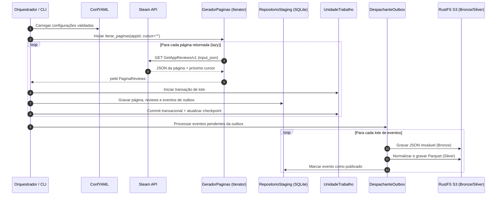

# Especificação Técnica — Steam Reviews Clustering v4.1
## Incremento 1: Fundação Arquitetural, Configuração Declarativa, Ingestão Lazy Steam, Staging Transacional e Data Lake

- **Status:** Proposta Técnica para Aprovação Humana (Approval Gate)
- **Autor / Persona:** `@pm` em conjunto com `@ml_architect`, `@data_engineer` e `@devops`
- **Data:** 24/10/2026
- **Fonte de Verdade:** [`documentacao/especificacao_original_v4_1.md`](file:///home/rodrigo/PycharmProjects/agrupamento_comentarios_youtube/documentacao/especificacao_original_v4_1.md)
- **Inventário de Referência:** [`production_artifacts/inventario.md`](file:///home/rodrigo/PycharmProjects/agrupamento_comentarios_youtube/production_artifacts/inventario.md)

---

## 1. Visão Geral e Objetivos do Incremento

Este documento formaliza a arquitetura e os requisitos para o **Incremento 1** do projeto **Steam Reviews Clustering**. O objetivo primordial é estabelecer os alicerces estáveis da plataforma de dados, garantindo conformidade absoluta com as regras permanentes descritas no `AGENTS.md` e na especificação v4.1:

1. **Configuração Declarativa e Imutável:** Estabelecer a fachada única `ConfYAML` em `conf_yaml.py`, apoiada por modelos Pydantic estritos, eliminando qualquer uso de `eval`, `exec` ou caminhos com fallbacks implícitos.
2. **Arquitetura Orientada a Contratos:** Construir as interfaces de domínio sem acoplamento a bibliotecas de infraestrutura externa, aplicando os padrões GoF (Strategy, Factory/Registry, Adapter, Repository, Unit of Work, Observer, Facade).
3. **Coleta Steam com Geradores e Backpressure:** Implementar a extração paginada lazy da API Steam (`IUserReviewsService/GetAppReviews/v1`) via `Iterator[PaginaReviews]`, impedindo a materialização de grandes volumes na memória RAM.
4. **Staging Transacional com SQLite:** Persistir registros brutos e metadados de controle em banco transacional SQLite local com modo WAL, transações atômicas por lote e controle de checkpoints.
5. **Padrão Outbox e Publicação no Data Lake:** Desacoplar a gravação do banco transacional da escrita no RustFS S3 (Bronze original e Silver normalizado), garantindo reexecução idempotente e consistência eventual sem transações distribuídas frágeis.
6. **Eliminação Conflitante de PLN:** Assegurar que o texto das reviews seja armazenado exclusivamente para consulta humana e auditoria, sem qualquer extração de embeddings, lematização ou sentimento nesta etapa.

---

## 2. Escopo do Incremento Atual

### 2.1. O Que Está no Escopo (Fase 1)
- **Módulo de Configuração:**
  - Fachada `ConfYAML` (`app/configuracao_geral/conf_yaml.py`) e modelos Pydantic tipados (`extra="forbid"`).
  - Estrutura completa de 21 arquivos YAML declarativos na pasta `configuracoes/`.
  - Validação cruzada e geração de hash de versão da configuração.
  - Recriação de `.env.example` com placeholders seguros para a Steam e infraestrutura.
- **Contratos e Domínio (`app/dominio_contratos/`):**
  - Entidades imutáveis tipadas (`dataclass(frozen=True, slots=True)`): `ReviewSteam`, `AutorSteam`, `PaginaReviews`, `MetadadosColeta`.
  - Protocolos de abstração: `ClienteSteam`, `GeradorPaginas`, `RepositorioStaging`, `UnidadeTrabalho`, `PublicadorOutbox`, `ArmazenamentoLake`.
- **Ingestão e Cliente Steam (`app/extracao_steam/`):**
  - Adaptador HTTP para o serviço `IUserReviewsService/GetAppReviews/v1`.
  - Suporte a filtros documentados da API, conversão de enums numéricos e envio via `input_json`.
  - Gerador paginado lazy via cursor (`*`), detecção de loops, controle de backoff exponencial e tratamento de HTTP 429.
  - Modos de coleta: Histórica, Recente, Atualizada e Reconciliação Periódica.
- **Staging Transacional (`app/persistencia_staging/`):**
  - Adaptador SQLite (`AdaptadorSQLite`) com suporte a WAL e `busy_timeout`.
  - Esquema DDL com 7 tabelas relacionais (`execucoes_coleta`, `paginas_recebidas`, `reviews_atuais`, `reviews_historico`, `autores_observados`, `marcadores_coleta`, `eventos_publicacao`).
  - Implementação de `Unit of Work` e `RepositorioStaging` com processamento em lotes (`itertools.batched`).
- **Data Lake e Outbox (`app/gestao_datalake/`):**
  - Despachante de outbox para leitura de eventos pendentes.
  - Adaptador de armazenamento S3/RustFS utilizando `boto3`.
  - Escrita de particionamento da camada Bronze (`bronze/steam/reviews/appid=.../pagina_*.json`).
  - Escrita da camada Silver normalizada em formato Parquet (`pyarrow`).
- **Observabilidade Básica e Qualidade:**
  - Exportação de métricas Prometheus (`steam_pages_consumed_total`, `staging_batches_committed_total`, etc.).
  - Quality Gate inicial de validação estrutural de schemas e unicidade.
  - Suíte de testes automatizados com `pytest` e type checking estrito com `pyright`.

### 2.2. Fora de Escopo Deste Incremento (Fases Subsequentes)
- **Fase 2:** Engenharia de atributos tabulares, motor Polars alternativo, pipelines de pré-processamento (imputação, escalonamento, PCA), algoritmos KMeans, DBSCAN e HDBSCAN.
- **Fase 3:** Tuning de hiperparâmetros, avaliação silhouette/Davies-Bouldin, integração com tracking do MLflow e serving de modelos preditivos.
- **Fase 4:** Motor declarativo de regras de negócio pós-treino (Specification/Composite) e relatórios analíticos em Grafana.
- **Fase 5:** Adaptador para PostgreSQL como banco de staging em produção, análise temporal com alinhamento de clusters e módulos de expansão.

---

## 3. Diretrizes Arquiteturais e Padrões GoF Obrigatórios

1. **Regra de Nomenclatura e Pacotes:**
   - Todos os nomes próprios (classes, funções, métodos, atributos, exceções) serão em língua portuguesa.
   - Todo módulo ou pacote próprio conterá **exatamente duas palavras** separadas por `_` (exceções: `__init__.py`, `__main__.py`, `conftest.py`).
2. **Tipagem Estrita sem `Any`:**
   - Proibição absoluta do uso de `Any` ou `typing.Any`.
   - Utilização intensiva de `Protocol`, `TypeVar`, `Generic`, `tuple`, `override` e `final`.
   - `pyright` configurado em modo `strict` em todos os diretórios do projeto.
3. **Proibição de Condicionais de Domínio por String/Tecnologia (No-If):**
   - Não utilizar `if/elif` comparando nomes de banco ("sqlite", "postgres") ou tecnologias. A resolução será feita via **Registry** e **Factory**. Condicionais de fluxo de controle, validação de limites ou verificação de parada de iteradores são expressamente legítimas.
4. **Preservação Textual sem PLN:**
   - Os textos das avaliações e respostas de desenvolvedores serão preservados integralmente nas camadas Bronze e Staging apenas para fins de consulta do analista humano. Nenhum vetor de palavras, modelo BERT ou SpaCy será instanciado.

---

## 4. Estrutura Física do Projeto no Incremento 1

A organização das pastas no diretório `app/` respeitará rigorosamente o padrão de duas palavras:

```text
app/
├── configuracao_geral/
│   ├── __init__.py
│   ├── conf_yaml.py                   # Fachada única de configuração tipada
│   ├── modelos_configuracao.py        # Modelos Pydantic strict das configurações
│   └── validador_compatibilidade.py   # Validação semântica e cruzada entre YAMLs
├── dominio_contratos/
│   ├── __init__.py
│   ├── modelos_dados.py               # Dataclasses imutáveis do domínio (Review, Autor, Pagina)
│   ├── protocolos_extracao.py         # Interfaces de clientes e fontes de coleta
│   ├── protocolos_staging.py          # Interfaces de repositório, UoW e persistência
│   └── protocolos_datalake.py         # Interfaces de publicação outbox e S3
├── extracao_steam/
│   ├── __init__.py
│   ├── cliente_http.py                # Cliente de baixo nível requests/urllib com retry e backoff
│   ├── adaptador_steam.py             # Implementação do serviço IUserReviewsService
│   ├── gerador_paginas.py             # Iterator/Generator lazy paginado por cursor
│   └── controlador_resiliencia.py     # Gestão de HTTP 429, jitter e pausas
├── persistencia_staging/
│   ├── __init__.py
│   ├── conexao_sqlite.py              # Gestão da conexão SQLite (WAL, timeouts)
│   ├── esquema_tabelas.py             # DDL e criação das 7 tabelas do staging
│   ├── unidade_trabalho.py            # Unit of Work para demarcação transacional
│   ├── repositorio_sqlite.py          # Implementação de RepositorioStaging em SQLite
│   └── fabrica_staging.py             # Registry e Factory para instanciar persistência
├── gestao_datalake/
│   ├── __init__.py
│   ├── cliente_rustfs.py              # Conector S3 / RustFS via boto3
│   ├── escritor_bronze.py             # Persistência de JSON original imutável
│   ├── escritor_prata.py              # Normalização tabular em Parquet
│   └── despachante_outbox.py          # Consumidor de eventos da tabela de outbox
└── observabilidade_metricas/
    ├── __init__.py
    ├── registro_telemetria.py         # Métricas Prometheus instrumentadas
    └── validador_qualidade.py         # Quality Gate de tipos, integridade e duplicatas
```

---

## 5. Modelagem e Estrutura do Staging Relacional (SQLite)

O banco de dados SQLite local operará em modo **WAL (Write-Ahead Logging)** com as seguintes 7 tabelas relacionais mínimas:

1. `execucoes_coleta`: Registra cada sessão de coleta com `id_execucao` (UUID), `appid`, `estrategia`, `data_inicio`, `data_fim`, `status`, `total_paginas`, `total_reviews`, `erros`.
2. `paginas_recebidas`: Identificador idempotente da página, `id_execucao`, `appid`, `cursor_entrada`, `cursor_saida`, `hash_conteudo`, `total_registros`, `data_coleta`.
3. `reviews_atuais`: Registro atualizado indexado por `(appid, recommendationid)`, contendo `steamid`, `language`, `review_texto` (consulta humana), timestamps, métricas numéricas (`playtime_forever`, `playtime_at_review`, etc.), `hash_semantico`, `data_ultima_coleta`.
4. `reviews_historico`: Tabela de snapshots versionados com chave `(appid, recommendationid, versao_registro)` para manter a linhagem das atualizações feitas pelos usuários ao longo do tempo.
5. `autores_observados`: Métricas do autor (`steamid`, `appid`, `num_games_owned`, `num_reviews`, `playtime_forever`, `data_observacao`).
6. `marcadores_coleta`: Checkpoints de rastreamento por `appid` + `estrategia`, guardando o último cursor estável, instante de atualização e status.
7. `eventos_publicacao`: Tabela de **outbox** transacional (`id_evento`, `tipo_evento`, `chave_origem`, `payload_referencia`, `status_publicacao`, `tentativas`, `data_criacao`, `data_publicacao`).

---

## 6. Fluxo de Execução com Backpressure



---

## 7. Critérios de Aceite Mensuráveis (Definition of Done)

1. **Conformidade de Tipagem:** `pyright` executado no modo `strict` em todo o código criado com **0 erros** e nenhuma ocorrência de `Any`.
2. **Padrão de Nomenclatura:** Todos os módulos e pacotes com exatamente 2 palavras separadas por `_`. Classes e métodos exclusivamente em português.
3. **Consumo Lazy e Memória Constante:** O gerador de páginas consome a Steam página a página, sem acumular listas completas na memória. Teste com 1.000 reviews simuladas consome buffer constante.
4. **Atomicidade e Idempotência no Staging:** Ingestão interrompida e retomada não gera duplicidades na chave `(appid, recommendationid)` e retoma a partir do último checkpoint confirmado.
5. **Gravação no Data Lake via Outbox:** Publicação de lotes no RustFS S3 com arquivo JSON em `bronze/` e tabela normalizada em `silver/`, com status de outbox devidamente atualizado.
6. **Cobertura de Testes Automatizados:** Suíte de testes unitários e de integração cobrindo:
   - Validação da fachada `ConfYAML` e rejeição de chaves inválidas.
   - Padrão iterator do gerador Steam e tratamento de cursor repetido.
   - Rollback transacional da `UnidadeTrabalho` em caso de falha no lote.
   - Processamento e idempotência da outbox.

---

## 8. Avaliação de Riscos e Estratégias de Mitigação

| Risco Identificado | Impacto | Estratégia de Mitigação |
|---|---|---|
| **Rate Limit da Steam (HTTP 429)** | Alto | Implementação de `ControladorResiliencia` com backoff exponencial, jitter aleatório e pausa automática de até 300 segundos em caso de 429. |
| **Concorrência no SQLite** | Médio | Configuração de modo WAL (`PRAGMA journal_mode=WAL;`), timeout estendido (`busy_timeout=30000`) e garantia de escritor único por processo de ingestão. |
| **Permissões nas pastas montadas** | Médio | Pastas `app/` e `configuracoes/` atualmente pertencem a `root:root`. Criar os arquivos pelo ambiente seguro ou sugerir ajuste de permissões locais (`chown`) caso necessário. |
| **Vazamento acidental de segredos** | Crítico | Chave da Steam referenciada via `key_env: STEAM_API_KEY`, resolvida em runtime e mascarada em todos os registros de logs e métricas. |
