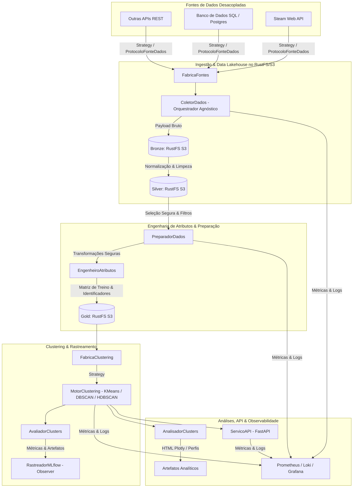

# Especificação Técnica — Plataforma de Clustering de Avaliações Steam

**Status:** Proposta Técnica Completa — Aguardando Aprovação do Usuário  
**Versão:** 1.0.0  
**Data:** 2026-10-24  
**Repositório:** `agrupamento_comentarios_youtube` (Projeto Steam Reviews Clustering)

---

## 1. Visão Geral e Objetivos

### 1.1 Objetivo do Projeto
Construir uma plataforma reutilizável, modular e desacoplada para ingestão, processamento e agrupamento não supervisionado (clustering) de avaliações da Steam a partir de atributos estritamente estruturados, configurável via arquivos YAML, com Processamento de Linguagem Natural (PLN) desativado por padrão.

### 1.2 Personas e Usuários
1. **Engenheiros de Dados:** Consomem dados da Steam Web API via ingestão incremental, gerenciam o Data Lakehouse (camadas Bronze, Silver e Gold) e monitoram a saúde operacional da coleta.
2. **Cientistas de Dados / Engenheiros de ML:** Experimentam algoritmos de clustering (KMeans, DBSCAN, HDBSCAN), ajustam hiperparâmetros e avaliam métricas intrínsecas via MLflow Tracking.
3. **Analistas de Negócio / Decisores de Produto:** Analisam o perfil dos grupos de jogadores (horas de jogo, votos, engajamento) por meio de dashboards visuais no Grafana e artefatos analíticos (gráficos interativos e tabelas de consulta humana das reviews originais).

### 1.3 Princípios de Design e Restrições Mandatórias
- **Python 3.12+ e Tipagem Estrita:** Código em modo estrito (`pyright`), sem uso de `Any`, `typing.Any` ou `from typing import *`. Uso de `Protocol`, `Generic`, `TypeVar`, `Literal`, `@override` e tipagem completa.
- **Nomenclatura em Português:** Módulos, classes, funções e exceções de domínio nomeados em português do Brasil, preservando nomes próprios de bibliotecas externas (`scikit-learn`, `MLflow`, `FastAPI`).
- **Desacoplamento de Fontes de Dados (Strategy & Factory):** A camada de ingestão é agnóstica de transporte. Por meio do `ProtocoloFonteDados` e da `FabricaFontes`, o pipeline suporta intercambiar a Steam Web API por bancos de dados relacionais (Postgres, SQLite) ou outras APIs REST, viabilizando o reuso do motor de clustering para novos projetos de agrupamento.
- **Cadastro e Metadados do Projeto em YAML:** O registro da entidade, domínio, mapeamento de identificadores de origem (`identificador_primario`, `identificador_contexto`, `campo_texto_consulta`) e atributos candidatos reside em `config/cadastro_projeto.yaml`. O código Python é 100% genérico, não contendo nomes específicos de colunas ou entidades de negócio.
- **Armazenamento Remoto Exclusivo no RustFS/S3:** A gestão do Data Lakehouse (camadas Bronze, Silver e Gold) ocorre estritamente no serviço RustFS/S3 integrado no Docker Compose (bucket `steam-reviews`). É expressamente vedada a criação de datalake ou persistência de dados em disco local.
- **PLN Desativado por Padrão:** O texto da avaliação (`review`) é persistido nas camadas Bronze e Silver para consulta humana, mas é rigorosamente excluído da matriz de treino.
- **Isolamento de Identificadores:** Identificadores (`steamid`, `recommendationid`, `appid`) nunca compõem os atributos de treino.
- **Segurança na Configuração YAML:** Nenhuma execução dinâmica de código (`eval`, `exec`) é permitida. As transformações e filtros utilizam um catálogo seguro de operações mapeadas internamente.
- **Reutilização da Infraestrutura Existente:** Integração direta com a stack Docker Compose já ativa (PostgreSQL, RustFS/S3, MLflow Server, Prometheus, Loki, Alloy e Grafana), sem criação de uma segunda stack.

---

## 2. Arquitetura de Software e Padrões de Projeto

A arquitetura do sistema adota princípios SOLID e padrões de projeto GoF com baixo acoplamento:



### 2.1 Padrões de Projeto Adotados
1. **Strategy / Factory de Ingestão (`ProtocoloFonteDados`, `FabricaFontes`):** Desacopla a origem dos dados do pipeline analítico. Suporta adaptadores para Steam API, Banco de Dados SQL e APIs REST genéricas.
2. **Strategy (`MotorClusteringProtocol`):** Encapsula os algoritmos de clustering (KMeans, DBSCAN, HDBSCAN nativo do scikit-learn). Permite trocar o algoritmo via configuração sem alterar o pipeline.
3. **Factory (`FabricaClustering`):** Resolve e instancia a estratégia correta com base no arquivo `clustering.yaml`.
4. **Adapter (`MotorProcessamentoProtocol`):** Abstrai operações tabulares para o motor padrão `Pandas`, permitindo futura extensão para `Polars` através da mesma interface.
5. **Repository (`RepositorioS3Lakehouse`):** Isola operações de I/O das camadas Bronze, Silver e Gold diretamente no RustFS/S3 (bucket `steam-reviews`), sem persistência no disco local.
6. **Observer (`ObservadorMLflow`):** Notificado durante o ciclo de modelagem para registrar hiperparâmetros, métricas, modelos e artefatos analíticos no MLflow Server.
7. **Facade (`FachadaPipeline`):** Ponto de entrada unificado que orquestra a execução end-to-end do fluxo (coleta, saneamento, engenharia, treinamento, avaliação e exportação).

---

## 3. Contratos de Dados e Esquema do Data Lakehouse

### 3.1 Esquema da Camada Silver
Campos estruturados normalizados a partir do endpoint `IUserReviewsService/GetAppReviews/v1/`:

| Coluna | Tipo | Finalidade | No Treino? |
| :--- | :--- | :--- | :--- |
| `recommendationid` | `str` | Chave primária única da review (deduplicação) | **Não** (Identificador) |
| `appid` | `int` | Identificador do jogo na Steam | **Não** (Identificador) |
| `steamid` | `str` | Identificador do autor | **Não** (Identificador) |
| `review` | `str` | Texto da avaliação | **Não** (Apenas consulta humana) |
| `timestamp_created` | `datetime` | Data/hora de publicação | **Não** (Metadado/Avaliação) |
| `timestamp_updated` | `datetime` | Data/hora da última alteração | **Não** (Metadado/Avaliação) |
| `voted_up` | `bool` | Recomendação positiva (`True`) ou negativa (`False`) | Opcional (Booleano codificado 0/1) |
| `votes_up` | `int` | Quantidade de votos úteis | **Sim** (Atributo numérico) |
| `votes_funny` | `int` | Quantidade de votos engraçados | **Sim** (Atributo numérico) |
| `weighted_vote_score` | `float` | Score de relevância ponderada | **Sim** (Atributo numérico) |
| `comment_count` | `int` | Quantidade de comentários | **Sim** (Atributo numérico) |
| `num_reviews` | `int` | Total de reviews já feitas pelo autor | **Sim** (Atributo numérico) |
| `playtime_forever` | `int` | Tempo total de jogo do autor (minutos) | **Sim** (Atributo numérico) |
| `playtime_last_two_weeks`| `int` | Tempo de jogo nas últimas 2 semanas (minutos) | **Sim** (Atributo numérico) |
| `playtime_at_review` | `int` | Tempo de jogo no momento da review (minutos) | **Sim** (Atributo numérico) |
| `last_played` | `datetime` | Data/hora da última sessão de jogo | **Não** (Metadado/Avaliação) |

### 3.2 Catálogo Seguro de Transformações (Sem `eval`/`exec`)
O pré-processamento (`preprocessamento.yaml`) e engenharia de atributos utilizam um registro fechado e tipado:
- **Imputação:** `media`, `mediana`, `mais_frequente`, `constante` (via `SimpleImputer`).
- **Escalonamento:** `padrao` (`StandardScaler`), `robusto` (`RobustScaler`), `minmax` (`MinMaxScaler`), `maxabs` (`MaxAbsScaler`).
- **Transformações Numéricas:** `log1p` (`np.log1p`), `power` (`PowerTransformer`), `quantile` (`QuantileTransformer`).
- **Detecção/Tratamento de Outliers:** `iqr` (Intervalo Interquartil com corte configurável), `isolation_forest`. Ação: sinalizar coluna booleana ou filtrar.
- **Redução Dimensional:** `pca` (`PCA`), `truncated_svd` (`TruncatedSVD`) para projeções 2D/3D.

### 3.3 Ordem de Execução no Processamento Tabular
A esteira de processamento tabular segue estritamente a ordem:
1. **Transformação de Colunas Existentes (PRIMEIRO):** executa as operações configuradas em `transformacoes` (ex.: `log1p`, divisões por constante, normalizações).
2. **Criação de Novas Colunas (DEPOIS):** cria os novos atributos configurados em `criacao_colunas` (com `habilitado: false` por padrão por atributo), avaliando com segurança as expressões correspondentes ao motor ativo (`expressao_pandas` ou `expressao_polars`). Dessa forma, as novas colunas já dispõem dos dados transformados no passo anterior.

---

## 4. Matriz de Compatibilidade dos Algoritmos de Clustering

| Capacidade / Algoritmo | KMeans | DBSCAN | HDBSCAN |
| :--- | :--- | :--- | :--- |
| **Origem** | `sklearn.cluster.KMeans` | `sklearn.cluster.DBSCAN` | `sklearn.cluster.HDBSCAN` |
| **Possui Centroides?** | Sim (`cluster_centers_`) | Não | Não |
| **Trata Ruído / Outliers?** | Não (atribui 100% dos pontos) | Sim (rótulo `-1`) | Sim (rótulo `-1`) |
| **Suporta Previsão Out-of-Sample?**| Sim (`predict`) | Não (transdutivo puro) | Sim (via `approximate_predict` do sklearn) |
| **Determinação de Clusters** | Fixado pelo usuário (`k`) | Baseado em densidade (`eps`, `min_samples`) | Hierárquico por densidade (`min_cluster_size`) |
| **Métricas Aplicáveis** | Silhouette, Davies-Bouldin, Calinski-Harabasz | Silhouette (pontos sem ruído), Taxa de Ruído | Silhouette (pontos sem ruído), Taxa de Ruído |

> [!IMPORTANT]
> O módulo `AvaliadorClusters` calcula métricas como Silhouette apenas para amostras não rotuladas como ruído (`rótulo != -1`), reportando separadamente a proporção de ruído. Caso haja apenas um cluster ou apenas ruído, o sistema emite diagnóstico seguro sem levantar exceção fatal.

---

## 5. Estrutura Proposta de Módulos em `app/`

```
app/
├── __init__.py
├── conf_yaml.py                  # Modelos Pydantic v2 estritos e leitor centralizado ConfYAML
├── excecoes.py                   # Hierarquia de exceções de domínio em português
├── contratos/
│   ├── __init__.py
│   ├── fonte_dados.py           # Protocol para fontes de dados
│   ├── motor_processamento.py   # Protocol para motores tabulares (Pandas/Polars)
│   ├── motor_clustering.py      # Protocol para algoritmos de clustering
│   ├── repositorio.py           # Protocol para persistência de dados
│   └── observador.py            # Protocol para rastreamento (Observer)
├── ingestao_fontes/
│   ├── __init__.py
│   ├── fabrica_fontes.py            # Factory para resolver a fonte (steam_api, banco_dados, api_rest)
│   ├── coletor_dados.py             # Orquestrador agnóstico de ingestão incremental
│   ├── cliente_http_resiliente.py   # Cliente HTTP genérico com retries, timeouts e backoff
│   └── adaptadores/
│       ├── __init__.py
│       ├── adaptador_steam.py       # Especialização para a API da Steam (cursor e appid)
│       ├── adaptador_banco_dados.py # Adaptador para Banco de Dados SQL (Postgres/SQLite)
│       └── adaptador_api_rest.py    # Adaptador para APIs REST genéricas
├── gestao_datalake/
│   ├── __init__.py
│   └── repositorio_s3_lakehouse.py   # Repositório remoto no RustFS/S3 (sem I/O local)
├── processamento_dados/
│   ├── __init__.py
│   ├── catalogo_operacoes.py    # Registro de operações seguras (sem eval/exec)
│   ├── motor_pandas.py          # Implementação tabular Pandas
│   └── motor_polars.py          # Implementação tabular Polars (Strategy)
├── preprocessamento_ml/
│   ├── __init__.py
│   ├── preparador_dados.py      # Filtros, limpeza e validação de schema
│   ├── engenheiro_atributos.py  # Seleção segura e transformações numéricas
│   └── transformadores.py       # Imputador, escalonador e redutor PCA
├── treinamento_pipeline/
│   ├── __init__.py
│   ├── motores_sklearn.py       # Strategies para KMeans, DBSCAN e HDBSCAN
│   ├── fabrica_clustering.py    # Factory para resolver algoritmo a partir do YAML
│   ├── avaliador_clusters.py    # Métricas adaptativas (Silhouette, Ruído, etc.)
│   └── rastreador_mlflow.py     # Observer que reporta ao MLflow Server
├── analise_clusters/
│   ├── __init__.py
│   ├── gerador_graficos.py      # Gráficos interativos Plotly (dispersão, boxplot, perfil)
│   └── analisador_clusters.py   # Perfil de jogadores, correlações e tabela de reviews
├── servico_api/
│   ├── __init__.py
│   ├── aplicacao_fastapi.py     # Fábrica da aplicação FastAPI
│   ├── esquemas_api.py          # Modelos de requisição e resposta Pydantic
│   └── rotas.py                 # Endpoints /health, /ready, /metrics, /clusters, /predict
└── fachada_pipeline.py          # Facade unificada de orquestração do fluxo completo
```

---

## 6. Observabilidade e Telemetria

### 6.1 Métricas Prometheus
- **Operacionais:**
  - `steam_coleta_duracao_segundos` (Histogram p50/p95/p99)
  - `steam_coleta_requisicoes_total` (Counter por status e appid)
  - `steam_coleta_erros_total` (Counter de retries e timeouts)
  - `steam_reviews_coletadas_total` (Counter de avaliações processadas)
  - `pipeline_etapa_duracao_segundos` (Histogram por etapa: extracao, silver, gold, treino)
- **Analíticas / ML:**
  - `clustering_silhouette_score` (Gauge)
  - `clustering_davies_bouldin_index` (Gauge)
  - `clustering_calinski_harabasz_score` (Gauge)
  - `clustering_proporcao_ruido` (Gauge para DBSCAN/HDBSCAN)
  - `clustering_quantidade_clusters` (Gauge)

### 6.2 Dashboards Grafana
Provisionamento automático em `config_ob/dashboards/`:
1. `dashboard_operacional_coleta.json`: Latência, requisições, retries, freshness e contagem de reviews.
2. `dashboard_qualidade_datalake.json`: Volume em Bronze/Silver/Gold, duplicatas descartadas e integridade de schema.
3. `dashboard_experimentos_clustering.json`: Histórico de modelos treinados, métricas de agrupamento e proporção de ruído.
4. `dashboard_perfil_clusters.json`: Comparativo de horas jogadas, votos e sentimento (`voted_up`) entre os clusters.

---

## 7. Plano de Entregáveis Incrementais e Critérios de Aceitação

### Fase 1: Configuração Centralizada & Contratos Base
- **Entregáveis:** `conf_yaml.py`, `excecoes.py`, `contratos/` com Protocols estritos e validação completa dos 13 arquivos YAML.
- **Critérios de Aceitação:** 100% de cobertura nos testes de leitura/validação YAML; rejeição automática de parâmetros espúrios e ausência de `eval`/`exec`; aprovação no `pyright --mode strict`.

### Fase 2: Ingestão de Fontes Desacopladas & Camadas Bronze/Silver no RustFS/S3
- **Entregáveis:** `fabrica_fontes.py`, `coletor_dados.py`, `cliente_http_resiliente.py`, `adaptadores/adaptador_steam.py`, `adaptadores/adaptador_banco_dados.py`, `adaptadores/adaptador_api_rest.py`, `repositorio_s3_lakehouse.py`.
- **Critérios de Aceitação:** Suporte a múltiplas fontes via Strategy e resolução dinâmica via Factory (`steam_api`, `banco_dados`, `api_rest`); paginação por cursor (APIs) e offset/timestamp (Banco de Dados); retries com backoff exponencial; deduplicação idempotente; persistência direta no bucket `steam-reviews` do RustFS/S3 (sem I/O local) com particionamento e metadados nas camadas Bronze e Silver. Testes unitários com mocks de API Steam, banco SQL e chamadas S3.

### Fase 3: Engenharia de Atributos & Pré-processamento Seguro
- **Entregáveis:** `preparador_dados.py`, `engenheiro_atributos.py`, `catalogo_operacoes.py`, `motor_pandas.py`.
- **Critérios de Aceitação:** Separação estrita de identificadores e texto; transformações seguras via catálogo tipado; gravação da camada Gold (matriz X pronta para treino). Testes de sanidade de schema e imputação.

### Fase 4: Motor de Clustering, Avaliação e MLflow Tracking
- **Entregáveis:** `motores_sklearn.py`, `fabrica_clustering.py`, `avaliador_clusters.py`, `rastreador_mlflow.py`.
- **Critérios de Aceitação:** Execução de KMeans, DBSCAN e HDBSCAN; cálculo adaptativo de métricas com isolamento de ruído; registro bem-sucedido de parâmetros, métricas e modelo no MLflow Server (`http://mlflow-server:5000`); testes unitários e de casos de borda (ruído total, cluster único).

### Fase 5: Análises de Negócio, API FastAPI e Observabilidade
- **Entregáveis:** `analisador_clusters.py`, `gerador_graficos.py`, `servico_api/`, dashboards Grafana em `config_ob/dashboards/`, `fachada_pipeline.py`.
- **Critérios de Aceitação:** Gráficos interativos em HTML e perfil de cluster; API FastAPI expondo `/health`, `/ready`, `/metrics`, `/clusters` e `/predict` (condicionado ao algoritmo); instrumentação Prometheus ativa; testes de integração ponta a ponta.

---

## 8. Estratégia de Testes e QA

1. **Testes Unitários:** Cada módulo terá suite correspondente em `tests/` (`teste_conf_yaml.py`, `teste_coletor_steam.py`, `teste_preparador.py`, `teste_clustering.py`, `teste_avaliador.py`, `teste_api.py`).
2. **Casos de Borda Obrigatórios:**
   - Resposta vazia da Steam API.
   - Presença de duplicatas e identificadores nulos.
   - Atributos com variância zero ou dados totalmente ausentes.
   - DBSCAN classificando 100% dos dados como ruído (`-1`).
   - Algoritmo que produz um único cluster (tratamento gracioso de métricas).
   - Tentativa de chamar `/predict` em algoritmo sem suporte (ex: DBSCAN).
3. **Verificação Estática:** Execução automatizada de `pyright` (modo estrito) e `ruff` antes de qualquer entrega.
