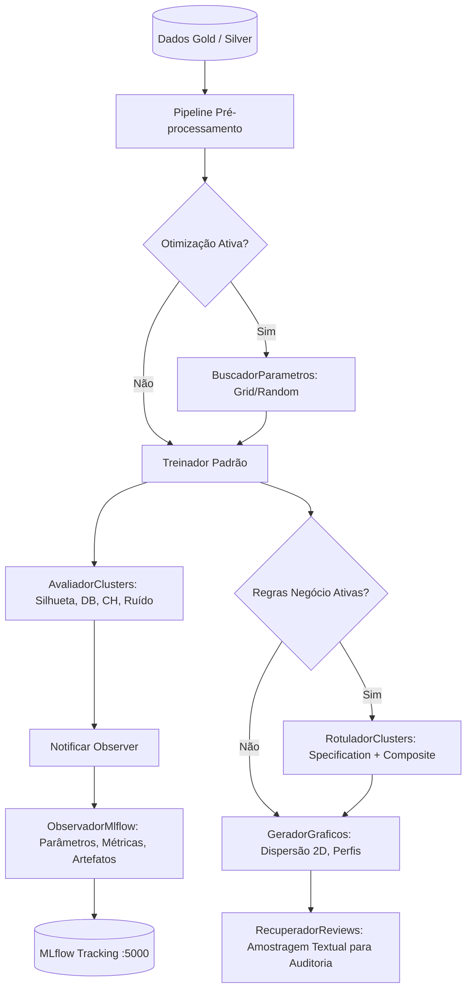

# Especificação Técnica — Incremento 3 (Fase 3): MLOps, MLflow Tracking, Regras de Negócio e Visualização Executiva

- **Versão:** 1.0 (Rastreável à Especificação v4.1)
- **Data:** 24/10/2026
- **Autor / Papel:** @pm & @arquiteto
- **Status:** Proposta Técnica para Homologação Humana

---

## 1. Visão Geral e Alinhamento à Especificação v4.1

Este incremento implementa as seções **12 (MLflow e ciclo de vida dos modelos)**, **13 (Regras de negócio pós-treinamento)**, **14 (EDA e visualizações pós-treino)** e **16 (Observabilidade analítica)** da [`documentacao/especificacao_original_v4_1.md`](file:///home/rodrigo/PycharmProjects/agrupamento_comentarios_youtube/documentacao/especificacao_original_v4_1.md).

O objetivo central é conectar o pipeline de treinamento da camada Gold com o servidor **MLflow** ativo, implementar a publicação desacoplada via padrão GoF **Observer**, fornecer busca e otimização de hiperparâmetros, aplicar regras semânticas de negócio (Specification + Composite) sem alterar os rótulos de cluster, expor relatórios visuais/gráficos (EDA) e disponibilizar a recuperação analítica de reviews originais para inspeção humana.

---

## 2. Escopo do Incremento 3

### 2.1. Itens no Escopo
1. **Integração com MLflow via GoF Observer (`app/integracao_mlflow/`):**
   - Protocolo tipado `ObservadorTreinamento` e implementação `ObservadorMlflow`.
   - Registro de parâmetros (hiperparâmetros, hashes SHA-256 das configurações YAML, versão do dataset).
   - Registro de métricas de agrupamento (Silhouette geral e sem ruído, Davies-Bouldin, Calinski-Harabasz, proporção de ruído, tamanhos dos grupos).
   - Log de artefatos: pipeline de pré-processamento ajustado, modelo serializado (conforme catálogo de capacidades), metadados de features e sumários estatísticos.
   - Padrão Null Object (`ObservadorNulo`) quando MLflow estiver desativado no YAML.
2. **Otimização de Hiperparâmetros Desacoplada (`app/otimizacao_hiperparametros/`):**
   - Buscador de hiperparâmetros (`BuscadorParametros`) para KMeans, DBSCAN e HDBSCAN conforme `configuracoes/machine_learning/otimizacao.yaml`.
   - Avaliação multicritério (não depender de uma única métrica) para desempate e seleção do modelo campeão.
3. **Motor Declarativo de Regras de Negócio Pós-Treinamento (`app/regras_negocio/`):**
   - Especificação GoF Specification + Composite para predicados de negócio configuráveis em `configuracoes/analises/negocio.yaml`.
   - Rotulador semântico (`RotuladorClusters`) que enriquece os clusters e reviews com rótulos descritivos de personas/padrões de consumo (ex: `veteranos_satisfeitos`, `novatos_evasivos`) sem forçar retreinamento ou alterar os IDs de cluster originais.
4. **Visualizações e EDA Executiva (`app/visualizacao_dados/`):**
   - Gerador de gráficos e perfis (`GeradorGraficos`): dispersão 2D (PCA/projeção), distribuição de clusters e boxplots/perfis de métricas com backend Plotly exportável para JSON/HTML.
   - Camada desacoplada da renderização para permitir integração com Grafana ou visualização direta.
5. **Consulta Analítica de Reviews Textuais (`app/servico_consulta/`):**
   - Serviço analítico (`RecuperadorReviews`) para resgatar e inspecionar reviews brutas originais por cluster/segmento para consumo humano direto, cumprindo a diretriz de "sem PLN / texto exclusivamente para consulta humana".

### 2.2. Fora de Escopo
- Modelagem de Linguagem Natural (PLN, LLM, BERT, TF-IDF, embeddings ou sentimento textual).
- Criação de novos serviços ou duplicação do Docker Compose (utilizar os contêineres e portas existentes: MLflow em `:5000`, Grafana em `:3000`).
- Treinamento online ou streaming de modelos em tempo real.

---

## 3. Arquitetura de Módulos e Padrões GoF (Regra das 2 Palavras)

Todos os pacotes e módulos obedecem estritamente à regra de **exatamente duas palavras** separadas por `_`:

```text
app/
├── integracao_mlflow/
│   ├── __init__.py
│   ├── observador_treinamento.py   # Protocolo abstrato do Observer de MLOps
│   ├── observador_mlflow.py        # Adaptador real para o tracking server do MLflow
│   ├── observador_nulo.py          # Padrão GoF Null Object quando MLflow estiver inativo
│   └── registro_modelos.py         # Serialização de pipelines e registro do modelo campeão
├── otimizacao_hiperparametros/
│   ├── __init__.py
│   ├── avaliador_objetivo.py       # Função objetivo multicritério com penalização de ruído
│   └── buscador_parametros.py      # Grid e Random search respeitando limites do YAML
├── regras_negocio/
│   ├── __init__.py
│   ├── especificacao_negocio.py    # GoF Specification e Composite para predicados
│   └── rotulador_clusters.py       # Aplica regras declarativas pós-treino sem alterar clusters
├── visualizacao_dados/
│   ├── __init__.py
│   ├── gerador_graficos.py         # Gráficos 2D e perfis com Plotly (HTML/JSON)
│   └── painel_executivo.py         # Compilador de relatórios executivos em HTML/Markdown
└── servico_consulta/
    ├── __init__.py
    └── recuperador_reviews.py      # Consulta de reviews textuais originais por cluster para humanos
```

---

## 4. Diagrama de Fluxo do Ciclo de MLOps



---

## 5. Critérios Mensuráveis de Aceite

1. **Strict Type Checking:** `pyright` executado no modo `strict` em 100% dos novos módulos e testes com **0 errors, 0 warnings** e zero `Any`.
2. **Lint e Formatação:** `ruff check .` e `ruff format --check .` com 100% de conformidade.
3. **MLflow Tracking Operacional:** Teste de integração registrando uma execução completa no MLflow Server (`http://localhost:5000`), confirmando o log de:
   - Parâmetros e hash SHA-256 do YAML.
   - Métricas estatísticas de clustering.
   - Artefatos (pipeline ajustado, esquema de features, resumo estatístico).
4. **Isolamento de Negócio:** Teste unitário confirmando que o `RotuladorClusters` não altera os rótulos numéricos gerados pelos algoritmos de cluster.
5. **Inspeção Textual Segura:** Teste unitário demonstrando a recuperação de reviews textuais brutas agrupadas por cluster sem nenhuma transformação semântica ou de PLN.
6. **Cobertura de Testes:** Suíte pytest mantendo 100% dos testes anteriores passando e adicionando novos testes com tempo de execução inferior a 10s.

---

## 6. Riscos e Mitigações

| Risco Identificado | Impacto | Mitigação Arquitetural |
|---|---|---|
| Instabilidade ou queda temporária do servidor MLflow | Médio | Implementar tratamento de exceções de rede no `ObservadorMlflow` para que falhas de telemetria não abortem o fluxo analítico principal de dados. |
| Incompatibilidade de predição do modelo no MLflow | Médio | Validar `capacidades.suporta_predicao_fora_da_amostra` antes de registrar funções de serving/predição; para DBSCAN/HDBSCAN salvar apenas como artefato clusterizado sem predição indutiva. |
| Overhead de renderização gráfica em grandes volumes | Baixo | Adotar amostragem determinística com semente para geração dos gráficos de dispersão Plotly. |
| Vazamento de dados em regras de negócio | Alto | Regras operam exclusivamente sobre agregados (`median`, `mean`, percentuais) ou colunas explicitamente permitidas. |
