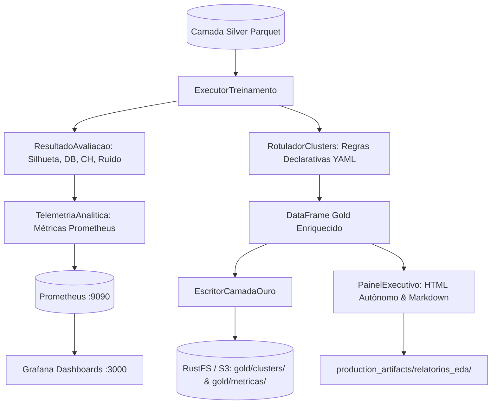

# Especificação Técnica — Incremento 4 (Fase 4): Camada Gold Analítica, Dashboards Grafana, Regras de Negócio Avançadas e EDA

- **Versão:** 1.0 (Rastreável à Especificação v4.1)
- **Data:** 24/10/2026
- **Autor / Papel:** @pm & @arquiteto
- **Status:** Proposta Técnica para Homologação Humana
- **Referência Oficial:** [`documentacao/especificacao_original_v4_1.md`](file:///home/rodrigo/PycharmProjects/agrupamento_comentarios_youtube/documentacao/especificacao_original_v4_1.md) (Seções 10, 13, 14, 16 e 21)

---

## 1. Visão Geral e Alinhamento à Especificação v4.1

Este incremento materializa a **Fase 4** descrita no Capítulo 21 da especificação v4.1:
> *"Fase 4: regras pós-treino, camada Gold analítica e dashboards de negócio."*

O objetivo é transformar os resultados do treinamento e da modelagem estatística (Fases 2 e 3) em produtos analíticos e operacionais consumíveis por analistas, cientistas de dados e tomadores de decisão:
1. **Persistência física da Camada Gold** no Data Lake S3/RustFS em formato Parquet colunar particionado por jogo (`appid`) e versão do modelo.
2. **Provisionamento de Dashboards Oficiais do Grafana** (`config_ob/dashboards/`) com painéis para monitoramento de clusters, linhagem Lakehouse e telemetria operacional da Steam.
3. **Catálogo Rico de Regras Declarativas de Negócio** em [`configuracoes/analises/negocio.yaml`](file:///home/rodrigo/PycharmProjects/agrupamento_comentarios_youtube/configuracoes/analises/negocio.yaml) (Specification + Composite) para rotulação semântica de perfis de jogadores (*personas*) sem retreinamento.
4. **Relatórios Executivos de EDA e Profiling Analítico** com geração automatizada de relatórios em HTML autônomo e Markdown persistidos no lake e no workspace.
5. **Telemetria de Métricas Analíticas no Prometheus** para alimentar os gauges e gráficos do Grafana em tempo real.

---

## 2. Escopo do Incremento 4

### 2.1. Itens no Escopo
1. **Escritor da Camada Gold no Data Lake (`app/gestao_datalake/escritor_ouro.py`):**
   - Criação de `EscritorCamadaOuro` compatível com o protocolo `ArmazenamentoLake`.
   - Serialização tabular Parquet comprimida (`snappy`) com particionamento hierárquico: `gold/clusters/appid={appid}/ano={ano}/mes={mes}/modelo_{nome}_{versao}.parquet`.
   - Serialização de métricas e tabelas resumo em `gold/metricas/appid={appid}/metricas_{versao}.parquet` e `resumo_executivo_{versao}.json`.
2. **Telemetria Analítica de Clusters no Prometheus (`app/observabilidade_metricas/`):**
   - Módulo `telemetria_clusters.py` ou expansão de `registro_telemetria.py` para exportar métricas Prometheus:
     - `steam_clusters_total`: contagem de clusters identificados.
     - `steam_clusters_ruido_proporcao`: taxa de ruído (-1).
     - `steam_clusters_silhouette_score`: coeficiente de silhueta.
     - `steam_clusters_davies_bouldin`: índice Davies-Bouldin.
     - `steam_clusters_calinski_harabasz`: índice Calinski-Harabasz.
     - `steam_gold_gravacoes_total`: contador de gravações na camada Gold.
3. **Dashboards Oficiais do Grafana para Steam (`config_ob/dashboards/`):**
   - `dashboard_steam_clusters.json`: volumetria por cluster, evolução de silhueta, boxplots de horas jogadas por cluster, percentual de avaliações positivas vs negativas, e visualização de personas de negócio.
   - `dashboard_steam_lakehouse.json`: contagem de partições Bronze (JSON), Silver (Parquet) e Gold (Parquet), eventos da outbox pendentes/publicados, throughput e tempos de I/O.
   - `dashboard_steam_operacional.json`: requisições por segundo, respostas HTTP 429, backoff, duração de lotes e latência do pipeline.
4. **Catálogo Declarativo de Regras de Negócio (`configuracoes/analises/negocio.yaml`):**
   - Parametrização declarativa de personas do ecossistema Steam:
     - `veteranos_criticos`: alta mediana de horas (ex: >= 100h) e alto percentual de reviews negativas (>= 50%).
     - `veteranos_leais`: alta mediana de horas (>= 100h) e alto percentual de reviews positivas (>= 70%).
     - `novatos_satisfeitos`: baixa mediana de horas (< 30h) e alto percentual de reviews positivas (>= 60%).
     - `novatos_frustrados`: baixa mediana de horas (< 20h) e alto percentual de reviews negativas (>= 50%).
     - `formadores_opiniao`: mediana elevada de votos úteis (`votes_up` >= 5).
5. **Orquestrador de Exportação Gold e Relatórios (`app/treinamento_pipeline/exportador_ouro.py`):**
   - Coordena a gravação no RustFS/S3, atualização da telemetria Prometheus, geração de artefatos de visualização e compilação do relatório executivo final.

### 2.2. Fora de Escopo
- Processamento de Linguagem Natural (PLN) ou embeddings (mantido estritamente desativado conforme v4.1).
- Modificação dos serviços do Docker Compose ou portas (mantém Grafana :3000, Prometheus :9090, RustFS :9000, MLflow :5000).
- Alteração destrutiva em dados ou migrações do banco.

---

## 3. Arquitetura de Módulos (Regra das 2 Palavras)

Todos os pacotes e módulos seguem rigorosamente a regra de **duas palavras** separadas por `_`:

```text
app/
├── gestao_datalake/
│   ├── escritor_ouro.py           # Persistência da camada Gold analítica no Lakehouse
│   └── ... (existentes: escritor_bronze, escritor_prata, cliente_rustfs, despachante_outbox)
├── observabilidade_metricas/
│   ├── telemetria_analitica.py    # Métricas Prometheus de clustering e qualidade Gold
│   └── ... (existentes: registro_telemetria, validador_qualidade)
└── treinamento_pipeline/
    ├── exportador_ouro.py         # Orquestra exportação Gold, telemetria e relatórios
    └── ... (existentes: executor_treinamento)

config_ob/dashboards/
├── dashboard_steam_clusters.json    # Painel Grafana de clusters e personas
├── dashboard_steam_lakehouse.json   # Painel Grafana de linhagem Bronze/Silver/Gold
└── dashboard_steam_operacional.json # Painel Grafana de ingestão e pipeline
```

---

## 4. Diagrama de Fluxo da Camada Gold e Negócio



---

## 5. Critérios Mensuráveis de Aceite

1. **Strict Type Checking:** `pyright` no modo `strict` em 100% dos novos módulos e testes com **0 errors, 0 warnings** e zero `Any`.
2. **Lint e Formatação:** `ruff check .` e `ruff format --check .` sem violações.
3. **Persistência Gold no Lakehouse:** Teste gravando DataFrame Gold em Parquet Snappy no RustFS/S3 e validando a leitura correta das colunas `cluster_id`, `rotulo_negocio`, `horas_jogadas_total`.
4. **Exportação de Métricas Prometheus:** Teste confirmando que métricas analíticas (`steam_clusters_total`, `steam_clusters_ruido_proporcao`, `steam_clusters_silhouette_score`, etc.) são registradas com labels de baixa cardinalidade (`appid`, `algoritmo`).
5. **Dashboards Grafana Validados:** Arquivos JSON sintaticamente válidos e compatíveis com a estrutura do Grafana 10+, contendo painéis para todas as métricas exigidas.
6. **Regras de Negócio Abrangentes:** Testes cobrindo a rotulação semântica com o catálogo de personas de games sem alteração dos clusters originais.
7. **Suíte Pytest Totalmente Aprovada:** 100% dos testes anteriores (49 testes) mais os novos testes da Fase 4 passando em tempo inferior a 10s.

---

## 6. Riscos e Mitigações

| Risco | Impacto | Mitigação Arquitetural |
|---|---|---|
| Alta cardinalidade em métricas Prometheus | Alto | Proibido o uso de `steamid`, `recommendationid` ou identificadores individuais em labels de métricas; usar apenas `appid` e `algoritmo`. |
| Concorrência de escrita de arquivos Gold | Médio | Caminhos de partição isolados por `appid`, partição temporal e identificador de lote/versão. |
| Incompatibilidade de dashboards JSON no Grafana | Baixo | Validação automatizada de schema JSON via `json.loads` nos testes unitários. |
