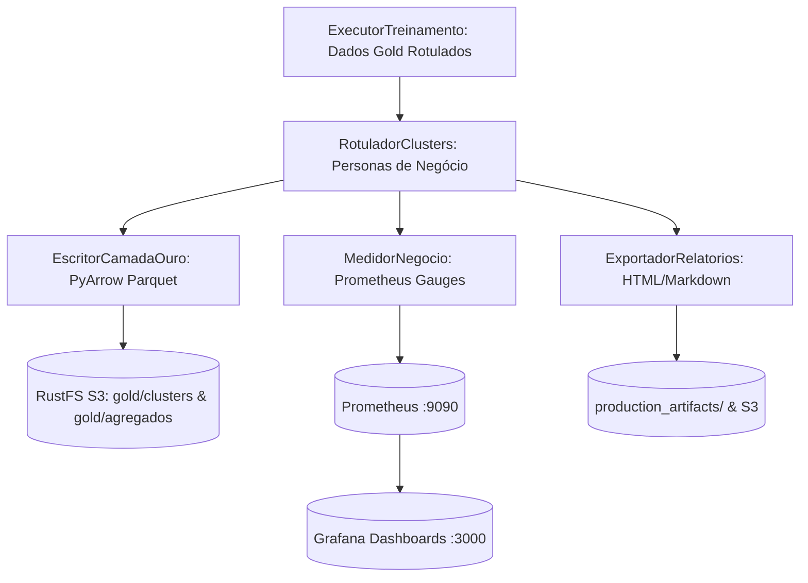

# Especificação Técnica — Incremento 4 (Fase 4): Camada Gold Analítica, Dashboards de Negócio e Observabilidade

- **Versão:** 1.0 (Rastreável à Especificação v4.1, Seções 9, 13, 14, 16 e 21)
- **Data:** 24/10/2026
- **Autor / Papel:** @pm & @arquiteto
- **Status:** Proposta Técnica para Homologação Humana

---

## 1. Visão Geral e Alinhamento à Especificação v4.1

Este incremento materializa as seções:
- **9 (Armazenamento em Data Lake / Lakehouse e Linhagem Bronze/Silver/Gold):** Persistência analítica da camada Gold em Parquet particionado no RustFS/S3.
- **13 (Regras de negócio pós-treinamento):** Integração das personas e regras declarativas completas em `configuracoes/analises/negocio.yaml`.
- **14 (EDA e visualizações pós-treino):** Dashboards de negócio e relatórios executivos automatizados.
- **16 (Observabilidade e telemetria analítica):** Exportação de métricas de negócio e alinhamento dos templates de dashboards do Grafana em `config_ob/dashboards/`.

---

## 2. Escopo do Incremento 4

### 2.1. Itens no Escopo
1. **Escritor da Camada Gold Analítica (`app/gestao_datalake/escritor_ouro.py`):**
   - Gravação do dataset Gold rotulado em formato colunar Parquet comprimido com Snappy no S3/RustFS sob `gold/clusters/appid={appid}/versao={versao}/dados_clusters.parquet`.
   - Gravação da tabela analítica agregada por cluster (`gold/agregados/appid={appid}/versao={versao}/resumo_clusters.parquet`), contendo volumetria, proporção, medianas de tempo de jogo, taxas de aprovação/positividade e personas semânticas.
2. **Catálogo Declarativo Completo de Personas de Jogadores (`configuracoes/analises/negocio.yaml`):**
   - Mapeamento formal de segmentos comportamentais da Steam via GoF Specification + Composite:
     - `jogadores_veteranos_criticos`: alta quilometragem (>= 100h) e insatisfação.
     - `entusiastas_engajados`: muitas horas jogadas (>= 80h), avaliação positiva e alto engajamento comunitário (`votes_up`).
     - `jogadores_casuais`: tempo moderado (< 30h) e avaliação positiva.
     - `novatos_em_churn`: pouco tempo de jogo (< 5h) e avaliação negativa.
     - `jogadores_intermediarios`: perfil mediano padrão.
3. **Métricas de Observabilidade de Negócio (`app/observabilidade_metricas/medidor_negocio.py`):**
   - Gauges e Counters Prometheus para acompanhar a volumetria por persona, proporção de ruído e indicadores de cluster em produção.
4. **Alinhamento dos Dashboards do Grafana (`config_ob/dashboards/`):**
   - Atualização e validação dos templates JSON em `config_ob/dashboards/`:
     - `dashboard_modelos_clusters.json`: painéis com volumetria por cluster, silhueta por execução, proporção de ruído, distribuição de personas de negócio.
     - `dashboard_datalake_lakehouse.json`: volumetria e contagens de partições Bronze, Silver e Gold.
5. **Exportador Automático de Relatórios Analíticos (`app/visualizacao_dados/exportador_relatorios.py`):**
   - Persistência estruturada do relatório executivo em Markdown e HTML interativo Plotly no disco de artefatos e/ou Lakehouse.

### 2.2. Fora de Escopo
- Processamento de Linguagem Natural (PLN, LLM, BERT ou análise de sentimento automática do texto).
- Alteração ou duplicidade de contêineres no Docker Compose.
- Modificação dos rótulos numéricos dos clusters originais.

---

## 3. Arquitetura de Módulos (Regra das 2 Palavras)

```text
app/
├── gestao_datalake/
│   ├── escritor_ouro.py            # Persiste dataset e agregados da camada Gold no S3/RustFS
├── observabilidade_metricas/
│   ├── medidor_negocio.py          # Expõe métricas Prometheus de personas e clusters
└── visualizacao_dados/
    ├── exportador_relatorios.py    # Automatiza a persistência de artefatos HTML/MD
configuracoes/
└── analises/
    └── negocio.yaml                # Catálogo declarativo completo de personas e regras
config_ob/
└── dashboards/
    ├── dashboard_modelos_clusters.json    # Dashboard de clusters e personas para o Grafana
    └── dashboard_datalake_lakehouse.json  # Dashboard de volumetria das camadas do Lakehouse
```

---

## 4. Diagrama de Fluxo da Camada Gold



---

## 5. Critérios Mensuráveis de Aceite

1. **Strict Type Checking:** `pyright` executado no modo `strict` em todo o workspace com **0 errors, 0 warnings, 0 informations** e zero `Any`.
2. **Lint e Formatação:** `ruff check .` e `ruff format --check .` 100% limpos.
3. **Persistência Gold no Lakehouse:** Teste validando a gravação física e leitura de arquivos Parquet da camada Gold (`dados_clusters.parquet` e `resumo_clusters.parquet`) com schema PyArrow válido.
4. **Telemetria de Negócio:** Métricas Prometheus registradas com labels de baixa cardinalidade (sem IDs pessoais ou de reviews).
5. **Conformidade dos Dashboards:** JSON dos dashboards do Grafana syntactically válidos e com variáveis alinhadas às métricas expostas.
6. **Suíte Pytest:** 100% de aprovação de todos os testes existentes mais novos testes da Fase 4.
